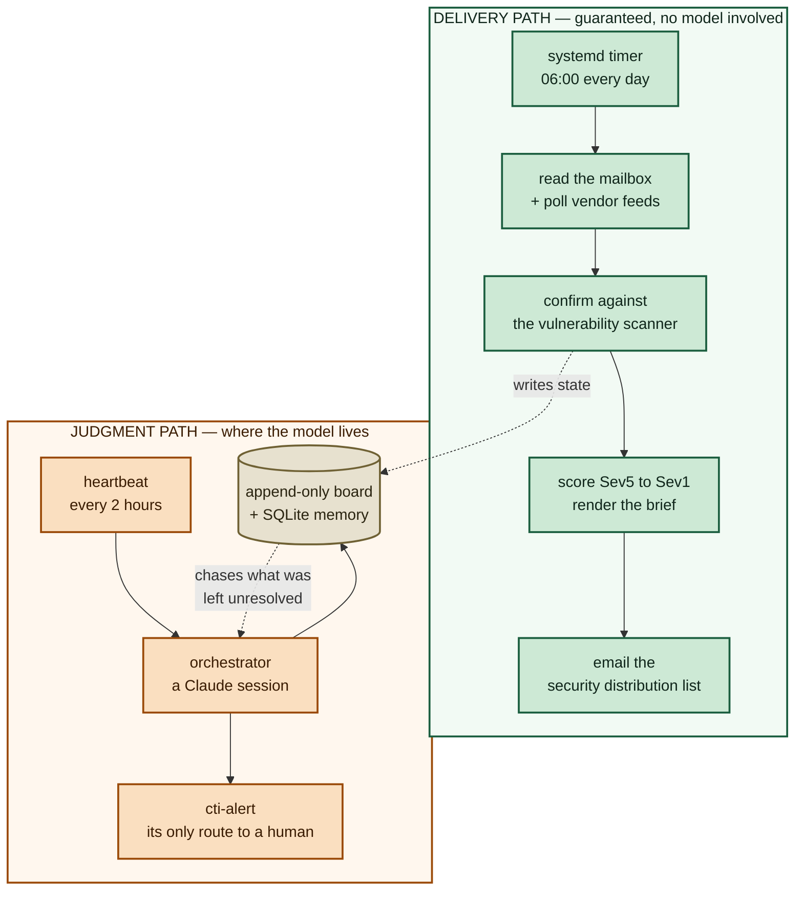
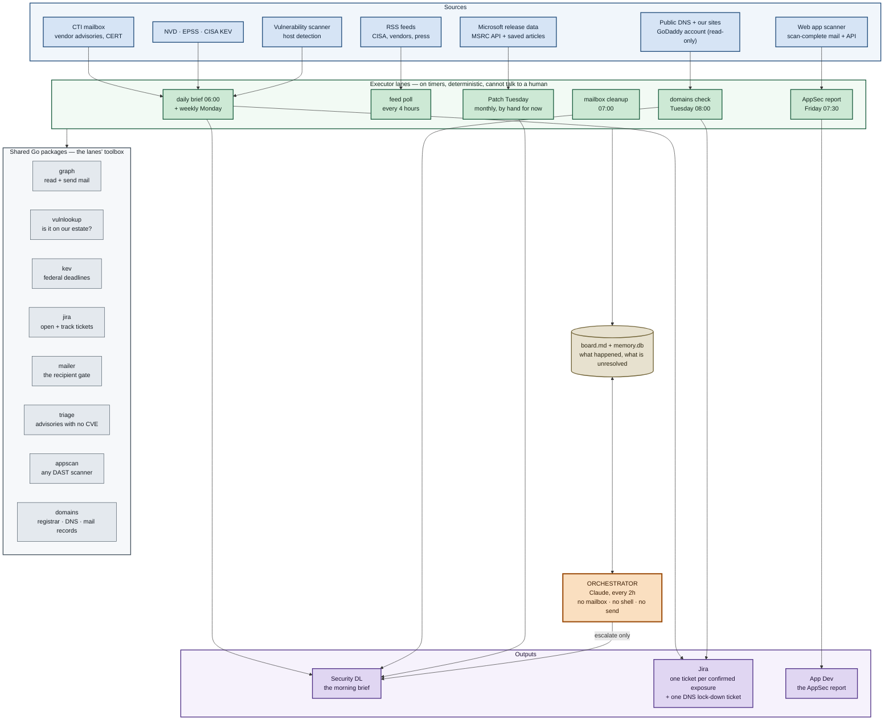

# How this works, and why it exists

Two pages. The first answers *why would I want this*; the second, *how does it
actually work*. For the full argument see
[AGENT-FLEET-PATTERN.md](AGENT-FLEET-PATTERN.md). After them come three
reference sections for people reading the code: the design decisions that will
surprise you, the eleven binaries, and the project layout.

---

## The problem

A security team has chores that have to happen every day, every week or every
month. Fifty vendor advisories arrive overnight and four of them concern
software you actually run. The tickets for last month's exposures need checking
against the scanner. Patch Tuesday needs writing up. Somebody should notice a
domain's transfer lock came off. Nobody has time for all of it, so in practice
the chores slip — and what mattered is found later, by somebody else, under
worse circumstances.

None of this is hard. It is *tedious* work with a fixed rhythm, and it is
exactly the kind of work that gets dropped first when a two-person security
team has a bad week. The fleet is an always-on junior analyst for it: each
chore is a **lane** on a timer, and every lane ends in a report a person can
act on.

## What it does

[LANES.md](LANES.md) lists every lane. Two examples show the shape.

The **threat-intel lane**: every morning at 06:00 an email arrives naming the vulnerabilities that are
**both** actively exploited in the wild **and** confirmed present on machines in
our estate, with the affected hostnames and a Jira ticket already open for IT.

Everything else is counted and not discussed.

The **application-security lane**: every Friday a separate email goes to the
people who own our **application code**: what the web application scanner found open on each of
our sites, which findings are new since the last scan, and whether each scan
logged in or covered only the public pages. Different audience, different
recipient list, enforced in code — the patching team and the application team
each get only the mail meant for them.

---

## The one design decision worth understanding

Most people assume an "AI agent" means the model runs the show. Here it is the
opposite, deliberately. The diagram follows the threat-intel lane; every other
lane has the same shape — a timer, a deterministic program, an allowlisted
email — and none of them involves the model:



**No report passes through the model.** If the model is slow, rate-limited,
out of credit, or refuses for reasons nobody can reproduce, the morning brief
still lands at 06:00, and every other lane's report on its own schedule. That is the difference between a tool you can put in
a compliance narrative and a demo.

The model does the work that genuinely needs judgment and where being wrong is
recoverable: chasing a finding nobody resolved, noticing a Sev5 that has been
open eleven days, spotting that a timer got disabled. It advises. It does not
deliver.

> **The general principle:** put the model where being wrong is recoverable, and
> keep it out of the path where being absent is unacceptable. A system that
> routes its guaranteed deliverable through a probabilistic component has a
> probabilistic deliverable.

## Why you can trust the output

| Property | How it is achieved |
|---|---|
| **Every report arrives even when the model does not** | No model in the delivery path at all |
| **"We have this" is a scanner fact, not a guess** | Every reported CVE is confirmed present by host detection before it is scored |
| **Silence means a quiet day, not a dead pipeline** | A failed lane escalates by email; a growing unread backlog escalates on its own |
| **It cannot mail the wrong people** | Recipients are a hard allowlist enforced in code, one per report; there is no default recipient, and a report never falls back to another report's list |
| **A wrong answer can be traced** | Every claim names its source; every ticket carries the full host list |

## What it will never do

It does not patch anything, change a firewall, or touch production. Remediation
is IT's job — the fleet does the legwork and people make the calls: it opens the
ticket and then reports that ticket's status in the brief until it closes.

It does not decide what a human may see. The analysis step annotates; it is
structurally unable to drop an item.

---

<div style="page-break-after: always;"></div>

## How it is built

Five boring parts. That is the point — each can be understood, tested and
repaired by someone who has never read the others.



### The five primitives

| Primitive | Here | Why it exists |
|---|---|---|
| **Orchestrator** | A Claude session every 2 hours | Judgment. Decides what to chase and what to say nothing about |
| **Executor lanes** | Seven systemd timers, plus the heartbeat's (Patch Tuesday's is off for now; the operator runs that lane by hand) | Deterministic work. Each does one thing and cannot reach a human |
| **Heartbeat** | `cti-agent-checkin.timer` | Turns a program into a presence. It wakes whether or not you asked |
| **Message board** | Append-only markdown | How parts that never run at the same time talk to each other |
| **Persistent memory** | SQLite | Continuity. Without it every beat is a stranger starting over |

### What each lane adds

Each answers a different question. Several feed the threat-intel brief, which
is the join across them; the rest report on their own.

- **What is being talked about?** — the mailbox and the feeds
- **Do we actually have it?** — the scanner, which turns an advisory into an
  inventory fact
- **Is the world attacking it?** — CISA KEV and exploit-prediction scoring
- **What didn't arrive in the mailbox?** — the feed poller, so coverage does not
  depend on who remembered to subscribe us
- **Has someone external set a deadline?** — federal remediation due dates
- **What did this month's Microsoft release land on us?** — Microsoft's own
  release data, cross-checked against a news write-up and correlated with the
  scanner, one row per update somebody installs
- **What does a human do with this?** — a Jira ticket, with the hostnames
  attached, because our team reports and IT remediates
- **Are our own applications exposed?** — the web application scanner, read
  from its own completion mail and API, and reported to the people who write
  the code. Every count says whether that scan logged in, because a zero from a
  scan that only saw the public pages is a different number. The scanner is
  behind a provider boundary, so a second one is a parser, not a rewrite
- **Can somebody impersonate us, or take a domain from us?** — the weekly
  domains check: registrar state (expiry, transfer lock, a domain leaving the
  account), dangling CNAMEs, certificates, and whether each domain's mail
  records match its row in the security team's decision chart (sends,
  receives, both, a SaaS sender, or no mail at all). The exact DNS changes go
  to IT as one Jira lock-down ticket. A nameserver change nobody planned is how
  a hijack looks from outside, so changes are diffed week over week
- **Is the fleet itself healthy and affordable?** — the heartbeat, rationed
  against the model subscription so a crash loop cannot exhaust it

### The constraints on the model

The orchestrator has no mailbox, no shell and no ability to address mail. It
may call a short allowlist of commands — named **per subcommand**, so it can
write its own notes but cannot record a digest as sent, rewrite a finding, or
mark a monthly release delivered — and nothing else. It cannot run any lane:
every one of them sends or moves mail, and timers (or the operator) own them. Its only route to a
person is `cti-alert`, which has no recipient argument. A test checks that
everything its instructions tell it to run is on that list, and that nothing
they forbid is.

Separately, the component that reads advisory text — which arrives at a
published address anyone can write to, and is therefore hostile input — runs
with **no tools at all**. It is handed one file and writes one file, and
everything it reports is checked back against the source text before it reaches
anyone.

---

## Design decisions worth knowing

These are the ones that will surprise you if you read the code without them.

**Presence comes only from the scanner.** An advisory saying a CVE is exploited
is context. Whether it is *here* is a separate question with a separate source,
and the report never conflates them. Every CVE comes back as one of
`PRESENT`, `NOT_PRESENT` or `UNKNOWN` — and `UNKNOWN` is load-bearing: it means
the scanner had no answer, not that the estate is clean.

**A QID is the unit of work, not a CVE.** Qualys maps every CVE in a monthly
cumulative update to the same QID, so 353 "present" CVEs can be twelve missing
patches. Keyed by CVE, the Patch Tuesday table was 353 rows stating one fact
hundreds of times; keyed by QID it is a dozen rows that each mean *patch this*.

**The vendor's own query leads.** The QQL Qualys publishes with each review,
reproduced byte-for-byte, returns every QID in the release with assets against
it. A query built from whatever this lane managed to correlate is a subset, and
is labelled as one.

**Four states, not three.** Exposure distinguishes "not measured" (the scanner
was never reached) from "not yet measurable" (no QID mapping exists yet) from
"measured, nothing open" from a real finding. An early version printed a
confident diagnosis of a KnowledgeBase it had never contacted.

**Suppression requires evidence.** The daily digest holds back a Patch Tuesday
release's CVEs only when a manifest says that synopsis was *delivered* — never
on a heuristic about vendors and dates, and never on a manifest from a run
whose email failed.

**Mailbox cleanup leaves things alone by default.** Only two kinds of message
ever move: an advisory the agent took a CVE from, and a message whose own
headers declare it an automatic reply. "The agent read it looking for CVEs and
found none" is not "this has been dealt with."

**Nothing can permanently delete mail.** `internal/graph` exposes
move-to-folder and nothing else; Graph's `DELETE` and purge endpoints are
deliberately not implemented.

**Every failure falls open.** A missing manifest, an unreadable state file, an
absent `FLEET_HOME` — each means *report more*, never *report less*. The
recurring bug in this system was never a crash; it was a check that ran and had
no effect, or a refusal indistinguishable from a quiet day.

**Reports are targeting lists.** They pair "exploitable" with "these machines",
are written `0600`, are gitignored, and go only to an allowlisted internal
distribution list. See [RUNBOOK → Report
sensitivity](RUNBOOK.md#13-report-sensitivity).

---

## The eleven binaries

| Binary | Run by | Purpose |
|---|---|---|
| `cti-agent` | `run-digest`, or by hand | Reads the mailbox, extracts CVEs, asks the scanner what is present, writes markdown. Holds back CVEs already covered by a **sent** Patch Tuesday synopsis, and lists every one it held |
| `cti-alert` | systemd `OnFailure=`, and `run-appscan` | Makes a failed unit loud. Always exits 0 — a non-zero exit would mark the *alerter* failed and make `systemctl --failed` misleading |
| `cti-appscan` | `run-appscan`, weekly | The application-security report, from the DAST scanner's own completion emails, with the KnowledgeBase fix for each finding and one Jira ticket per application (filed by `cti-jira --appscan-tickets`, assigned to the owner in `app-owners.txt`, with optional `watchers=`). Labels every count *authenticated* or *unauthenticated* scan, because a zero from a scan that never logged in is not the same number. Raises a fault only when a configured credential **failed**, or a scan did not finish |
| `cti-appreport` | `run-appscan` when `WAS_ATTACH_REPORT=1`; by hand to test | Fetches the DAST scanner's own per-application report (Qualys WAS: create, poll, download, delete) as a zip for `cti-jira --appscan-reports` to attach. Writes files only; the report carries the scan account's session cookies, so it is `0600` and deleted after attaching. The scanner is chosen by `APPSCAN_REPORT_PROVIDER` through `appscan.ReportFetcher` |
| `cti-domains` | `run-domains`, weekly | The domains check: registrar (read-only GoDaddy token, never auth codes), DNS, web, verified TLS, and mail posture by role, diffed against last week's state. Sends nothing; chained to `cti-mailer --lane dom`. `--actions-out` writes the DNS changes for `cti-jira --domains-actions` |
| `cti-budget` | `run-checkin`, before each beat | Rations the orchestrator's share of a shared Claude subscription: window and daily ceilings, exponential backoff after a rate limit |
| `cti-kev` | by hand, or a quiet heartbeat | CISA KEV remediation deadlines for CVEs the scanner actually found |
| `cti-patchtuesday` | `run-patchtuesday`, monthly (by hand for now) | The Patch Tuesday synopsis from Microsoft's release data (MSRC API), cross-checked against BleepingComputer: correlates the release against Host Detection using both the KnowledgeBase CVE→QID mapping **and** the QIDs Qualys publishes in the review's own QQL. One row per QID. Writes the release manifest the daily digest reads |
| `cti-mailer` | every lane, and by hand | The **single outbound channel**. Holds the `VM_ALLOW_TO` recipient gate, which covers Cc as well as To. `--check` decodes the token and reports the roles the tenant actually consented to. `--to-dev` sends a preview to `FLEET_DEV_EMAIL` only, subject prefixed `[DEV TEST]`. A port of `mailer.py`; see [SECURITY.md](SECURITY.md#why-two-languages-and-why-that-is-the-security-decision) |
| `cti-mailbox` | `run-mailbox-cleanup`, daily | The only binary that **modifies** the mailbox. Dry-run unless `--for-real`. Needs `Mail.ReadWrite`; cannot permanently delete. Archives the fleet's own reports only when their `X-CTI-Agent-Sent` header carries a valid signature |
| `cti-jira` | `run-digest`, between enrich and brief; `run-domains`, before the send (the email names the lock-down ticket) | Files one Jira ticket per confirmed KEV, Sev5 or CVSS 9.0+ CVE, with every QID and host, and tracks it by a label on the ticket so the same CVE is never ticketed twice. `--domains-actions` files the domains lane's DNS changes as one lock-down ticket, commenting on the open one only when the list changed. Writes nothing — no ticket, comment or attachment — without `--for-real` and a project in `JIRA_ALLOW_CREATE`. `--appscan-tickets` does the same per web application, and `--appscan-test <id>` files one unassigned, untracked `[TEST]` ticket to rehearse it. Optional `JIRA_CLOUD_ID` routes API calls through the Atlassian gateway for a scoped service-account token; `--check` also reports each Jira permission the fleet uses |

All eleven are stdlib-only. `go.mod` has no dependencies, and adding one would make
a C toolchain or a large generated tree a build-time requirement on the
deployment host.

```bash
task build              # all eleven into bin/
task test               # Go tests + Python lane tests
task ship               # fmt, build, test, lint, scan, gosec, govulncheck, then push
task --list             # everything else
```

Go throughout, with Python only where a standard-library SQL driver is needed -
[why that split is a security
decision](SECURITY.md#why-two-languages-and-why-that-is-the-security-decision).

Go is gated by `gofmt`, `go vet`, `staticcheck`, `golangci-lint`, `gosec` and
`govulncheck`. The Python lanes are gated by their own unit tests and a syntax
check — **no linter, formatter, type checker or security scanner**. That
asymmetry is known and tracked in
[SECURITY.md → known gaps](SECURITY.md#known-gaps-and-accepted-risks).

---

## Project layout

```text
README.md                      the front page and the documentation map
ARCHITECTURE.md                this page: how it works, the decisions, the layout
INTERFACES.md                  the Go interfaces a new tool plugs into
BACKLOG.md                     what is planned, and what is only an idea

cmd/cti-agent/                 the agent: mailbox -> CVEs -> scanner -> markdown
cmd/cti-alert/                 failure alerter, invoked by systemd OnFailure=
cmd/cti-appscan/               weekly application-security report from DAST email
cmd/cti-appreport/             the scanner's own per-application report, zipped, for the Jira ticket
cmd/cti-domains/               weekly domains check: registrar, DNS, web, mail records
cmd/cti-budget/                model-quota ledger for the orchestrator heartbeat
cmd/cti-jira/                  files and updates one ticket per KEV, Sev5 or CVSS 9.0+ CVE
cmd/cti-kev/                   CISA KEV remediation deadline report
cmd/cti-mailbox/               daily mailbox cleanup (the only writer)
cmd/cti-mailer/                the single outbound channel, and the recipient gate
cmd/cti-patchtuesday/          monthly Microsoft Patch Tuesday synopsis

internal/config/               environment/config loading, per-command requirements
internal/fleetenv/             the single fleet.env reader every command uses
internal/version/              the build stamp every command reports
internal/safelog/              makes attacker-influenced text safe for a log record
internal/cti/                  CTI parsing and CVE extraction
internal/graph/                Microsoft Graph mailbox reader, sendMail, move
internal/mailer/               per-lane recipient resolution and allowlist references
internal/budget/               rolling-window and daily ceilings, backoff
internal/kev/                  deadline bands, present-only filtering
internal/jira/                 Jira client and the one-ticket-per-CVE policy
internal/patchtuesday/         release dates, source parsing, exposure, QQL, manifest
internal/mailbox/              processed-message log and the cleanup decision table
internal/report/               markdown report writer, hostname redaction
internal/triage/              deterministic extractor, and the verifier over model JSON
internal/defender/             Defender for Cloud attack-path notification parsing
internal/ticketref/            what a Jira step tells a report: ticket key, action, link (validated)
internal/safelink/             Proofpoint/redirector unwrapping with a host allowlist
internal/shellgate/            shell lint: the patterns that make a runner exit quietly
internal/appscan/              DAST boundary: scan results, auth state, the report
internal/appscan/qualys/       Qualys WAS: notification parser, Findings API, report download
internal/qualysrl/             header-driven Qualys API rate limiter (WAS client)
internal/domains/              inventory, probes, findings by role, week-over-week diff
internal/domains/godaddy/      GoDaddy domain list (read-only PAT, never auth codes)
internal/vulnlookup/           provider-neutral lookup interface and result types
internal/vulnlookup/qualys/    Qualys implementation
internal/vulnlookup/crowdstrike/ placeholder for a future implementation
internal/vulnlookup/noop/      no scanner: exercises extraction only

man/man1/                      a man page for every operator command

fleet-kit/                     the always-on fleet (see fleet-kit/README.md)
fleet-kit/bin/dev-run          local pipeline runner: doctor/ingest/enrich/brief/send
fleet-kit/fleet/lanes/         enrich, scout, brief, mailer
fleet-kit/fleet/bin/           run-digest, run-checkin, run-patchtuesday,
                               run-appscan, run-domains, run-mailbox-cleanup,
                               fleet-board, fleet-db
fleet-kit/fleet/CLAUDE.md      the orchestrator's standing instructions
fleet-kit/fleet/agents/        the triage agent definition
fleet-kit/fleet/skills/        /checkin, /cti-digest, /scout-sweep, /patch-tuesday
fleet-kit/fleet/systemd/       service + timer pairs, generic layout
fleet-kit/fleet/systemd-fedora/ same, FHS layout for Fedora/RHEL
fleet-kit/install.sh           generic installer, everything under one directory
fleet-kit/install-fedora.sh    FHS installer: /opt, /etc, /var/lib
fleet-kit/tests/               lane tests (stdlib unittest, no network)
scripts/                       history scrub, exposure remediation notes,
                               cheatsheet-pdf.py (task cheatsheet:pdf)
```

---

## Where to go next

| You want to | Read |
|---|---|
| The full design argument | [AGENT-FLEET-PATTERN.md](AGENT-FLEET-PATTERN.md) |
| Run it, or fix it at 06:30 | [RUNBOOK.md](RUNBOOK.md) |
| Swap in a different scanner, registrar or ticketing tool | [INTERFACES.md](INTERFACES.md) |
| See what is planned | [BACKLOG.md](BACKLOG.md) |
| The threat model and accepted risks | [SECURITY.md](SECURITY.md) |
| What changed, and what upgrading requires of you | [CHANGELOG.md](CHANGELOG.md) |
