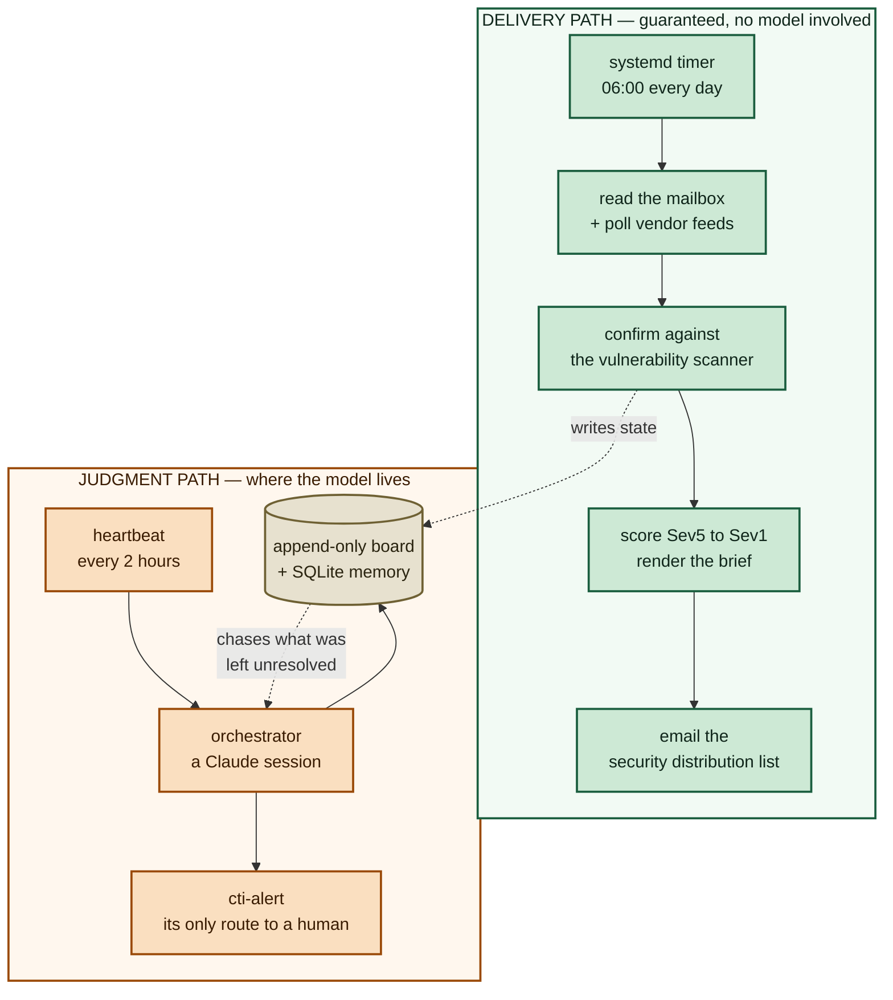
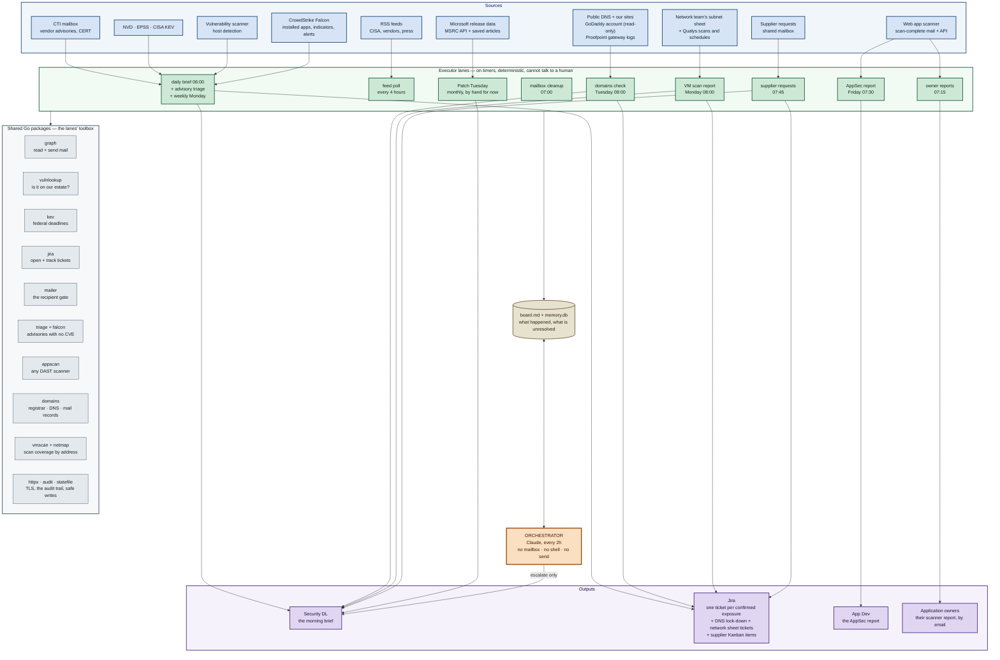

# How this works, and why it exists

Two pages. The first answers *why would I want this*; the second, *how does it
actually work*. For the full argument see
[AGENT-FLEET-PATTERN.md](AGENT-FLEET-PATTERN.md). After them come three
reference sections for people reading the code: the design decisions that will
surprise you, the twenty-two binaries, and the project layout.

---

## The problem

A security team has chores that have to happen every day, every week or every
month. Fifty vendor advisories arrive overnight and four of them concern
software you actually run. The tickets for last month's exposures need checking
against the scanner. Patch Tuesday needs writing up. Somebody should notice a
domain's transfer lock came off. Nobody has time for all of it, so in practice
the chores slip — and what mattered is found later, by somebody else, under
worse circumstances.

None of this is hard. It is *tedious* work with a fixed rhythm, and it is
exactly the kind of work that gets dropped first when a two-person security
team has a bad week. The fleet is an always-on junior analyst for it: each
chore is a **lane** on a timer, and every lane ends in a report a person can
act on.

## What it does

[LANES.md](LANES.md) lists every lane. Two examples show the shape.

The **threat-intel lane**: every morning at 06:00 an email arrives naming the vulnerabilities that are
**both** actively exploited in the wild **and** confirmed present on machines in
our estate, with the affected hostnames and a Jira ticket already open for IT.

Everything else is counted and not discussed.

The **application-security lane**: every Friday a separate email goes to the
people who own our **application code**: what the web application scanner found open on each of
our sites, which findings are new since the last scan, and whether each scan
logged in or covered only the public pages. Different audience, different
recipient list, enforced in code — the patching team and the application team
each get only the mail meant for them.

---

## The one design decision worth understanding

Most people assume an "AI agent" means the model runs the show. Here it is the
opposite, deliberately. The diagram follows the threat-intel lane; every other
lane has the same shape — a timer, a deterministic program, an allowlisted
email — and none of them involves the model:



**No report passes through the model.** If the model is slow, rate-limited,
out of credit, or refuses for reasons nobody can reproduce, the morning brief
still lands at 06:00, and every other lane's report on its own schedule. That is the difference between a tool you can put in
a compliance narrative and a demo.

The model does the work that genuinely needs judgment and where being wrong is
recoverable: chasing a finding nobody resolved, noticing a Sev5 that has been
open eleven days, spotting that a timer got disabled. It advises. It does not
deliver.

> **The general principle:** put the model where being wrong is recoverable, and
> keep it out of the path where being absent is unacceptable. A system that
> routes its guaranteed deliverable through a probabilistic component has a
> probabilistic deliverable.

## Why you can trust the output

| Property | How it is achieved |
|---|---|
| **Every report arrives even when the model does not** | No model in the delivery path at all |
| **"We have this" is a scanner fact, not a guess** | Every reported CVE is confirmed present by host detection before it is scored |
| **Silence means a quiet day, not a dead pipeline** | A failed lane escalates by email; a growing unread backlog escalates on its own |
| **It cannot mail the wrong people** | Recipients are a hard allowlist enforced in code, one per report; there is no default recipient, and a report never falls back to another report's list |
| **A wrong answer can be traced** | Every claim names its source; every ticket carries the full host list |

## What it will never do

It does not patch anything, change a firewall, or touch production. Remediation
is IT's job — the fleet does the legwork and people make the calls: it opens the
ticket and then reports that ticket's status in the brief until it closes.

It does not decide what a human may see. The analysis step annotates; it is
structurally unable to drop an item.

---

<div style="page-break-after: always;"></div>

## How it is built

Five boring parts. That is the point — each can be understood, tested and
repaired by someone who has never read the others.



### The five primitives

| Primitive | Here | Why it exists |
|---|---|---|
| **Orchestrator** | A Claude session every 2 hours | Judgment. Decides what to chase and what to say nothing about |
| **Executor lanes** | Ten systemd timers, plus the heartbeat's (Patch Tuesday's is off for now; the operator runs that lane by hand). Advisory triage runs inside the daily digest's unit | Deterministic work. Each does one thing and cannot reach a human |
| **Heartbeat** | `cti-agent-checkin.timer` | Turns a program into a presence. It wakes whether or not you asked |
| **Message board** | Append-only markdown | How parts that never run at the same time talk to each other |
| **Persistent memory** | SQLite | Continuity. Without it every beat is a stranger starting over |

### What each lane adds

Each answers a different question. Several feed the threat-intel brief, which
is the join across them; the rest report on their own.

- **What is being talked about?** — the mailbox and the feeds
- **Do we actually have it?** — the scanner, which turns an advisory into an
  inventory fact
- **Is the world attacking it?** — CISA KEV and exploit-prediction scoring
- **What didn't arrive in the mailbox?** — the feed poller, so coverage does not
  depend on who remembered to subscribe us
- **Has someone external set a deadline?** — federal remediation due dates
- **What did this month's Microsoft release land on us?** — Microsoft's own
  release data, cross-checked against a news write-up and correlated with the
  scanner, one row per update somebody installs
- **What does a human do with this?** — a Jira ticket, with the hostnames
  attached, because our team reports and IT remediates
- **Does an advisory with no CVE concern us?** — advisory triage, in the daily
  digest: a no-tools reader names the products and techniques, CrowdStrike
  Falcon says whether we run them, saw the indicators or alerted on the
  techniques, and a no-tools judge rates each from those facts alone
  (FLEET ADVISORIES). Code checks both models, and reports sightings itself
- **Are our own applications exposed?** — the web application scanner, read
  from its own completion mail and API, and reported to the people who write
  the code. Every count says whether that scan logged in, because a zero from a
  scan that only saw the public pages is a different number. The scanner is
  behind a provider boundary, so a second one is a parser, not a rewrite
- **Does each application's owner know?** — the owner reports: the scanner's
  own report for every scan that finished, emailed daily to the owner and
  watchers, because most owners are outside the company or have no Jira login.
  Application tickets exist only when a site asks for them (`WAS_TICKETS=1`)
- **Did the scans run, and do they reach every network?** — the VM scan
  weekly: which scans ran and which should have, from Qualys's own scan list and
  schedules, then the network team's subnet spreadsheet against the Asset Groups
  the scans targeted, by address. What the sheet gets wrong goes to the help
  desk as one ticket for the network team
- **Does this supplier need a third-party risk review?** — the supplier lane:
  each new request's form and text (never the tax or bank attachments), judged
  by a no-tools model and checked in code, which can only move an answer toward
  Unsure. Each Yes or Unsure becomes an item on the security team's board
- **Can somebody impersonate us, or take a domain from us?** — the weekly
  domains check: registrar state (expiry, transfer lock, a domain leaving the
  account), dangling CNAMEs, certificates, and whether each domain's mail
  records match its row in the security team's decision chart (sends,
  receives, both, a SaaS sender, or no mail at all). The exact DNS changes go
  to IT as one Jira lock-down ticket. A nameserver change nobody planned is how
  a hijack looks from outside, so changes are diffed week over week
- **Is the fleet itself healthy and affordable?** — the heartbeat, rationed
  against the model subscription so a crash loop cannot exhaust it, and ending
  every beat with a `cti-checkin/1` verdict checked against counts the model
  cannot change
- **Can we show what the fleet did?** — the audit trail: one RFC 5424 syslog
  line for every mail sent or moved, every Jira write and every owners change,
  kept 120 days and forwardable to a SIEM

### The constraints on the model

The orchestrator has no mailbox, no shell and no ability to address mail. It
may call a short allowlist of commands — named **per subcommand**, so it can
write its own notes but cannot record a digest as sent, rewrite a finding, or
mark a monthly release delivered — and nothing else. It cannot run any lane:
every one of them sends or moves mail, and timers (or the operator) own them. Its only route to a
person is `cti-alert`, which has no recipient argument. It reads the journal
only through `fleet-journal`, which takes `cti-agent-*` units and no option that
writes, and lists timers only through `fleet-timers`, which takes `--all` and
`cti-agent-*` patterns and no option that reaches another host. A Bash hook, `checkin-bash-guard`, refuses
any beat command with redirection, pipes, chaining, expansion (`$`, globs, `~`) or a
`NAME=` prefix, so a granted prefix cannot become a file write or leak a secret; the board
grant is `say`, `read`, `tail`, `resolve` and `expire` (no `post`, which names its own
sender, and no `prune`) and the budget grant is `status` only. It starts in a root-owned directory (`/opt/cti-agent/orchestrator`) that
holds its instructions, under a root-owned settings file, and `run-checkin`
refuses a beat if the service account's reach holds any Claude Code file that
could steer it. A test checks that
everything its instructions tell it to run is on that list, and that nothing
they forbid is.

Separately, the components that read hostile input — advisory text, which
arrives at a published address anyone can write to, and supplier requests from
outside senders — run with **no tools at all**, no fleet secrets in their
environment and an empty home directory. Each is handed one file and writes one
JSON object, and code checks it before it reaches anyone: triage's reader is
checked back against the advisory, and triage's judge never sees the advisory,
only the numbered facts the Falcon lookups returned, so planted text cannot
steer a verdict. Every lane that calls a model gets these controls from one
shared library (`share/model-lane.sh`), and the heartbeat's behaviour is
measured by evals (`task eval:checkin`) before a change to its instructions,
grants or model ships; see [HARNESS.md](HARNESS.md).

---

## Design decisions worth knowing

These are the ones that will surprise you if you read the code without them.

**Presence comes only from the scanner.** An advisory saying a CVE is exploited
is context. Whether it is *here* is a separate question with a separate source,
and the report never conflates them. Every CVE comes back as one of
`PRESENT`, `NOT_PRESENT` or `UNKNOWN` — and `UNKNOWN` is load-bearing: it means
the scanner had no answer, not that the estate is clean.

**A QID is the unit of work, not a CVE.** Qualys maps every CVE in a monthly
cumulative update to the same QID, so 353 "present" CVEs can be twelve missing
patches. Keyed by CVE, the Patch Tuesday table was 353 rows stating one fact
hundreds of times; keyed by QID it is a dozen rows that each mean *patch this*.

**The vendor's own query leads.** The QQL Qualys publishes with each review,
reproduced byte-for-byte, returns every QID in the release with assets against
it. A query built from whatever this lane managed to correlate is a subset, and
is labelled as one.

**Four states, not three.** Exposure distinguishes "not measured" (the scanner
was never reached) from "not yet measurable" (no QID mapping exists yet) from
"measured, nothing open" from a real finding. An early version printed a
confident diagnosis of a KnowledgeBase it had never contacted.

**Suppression requires evidence.** The daily digest holds back a Patch Tuesday
release's CVEs only when a manifest says that synopsis was *delivered* — never
on a heuristic about vendors and dates, and never on a manifest from a run
whose email failed.

**Mailbox cleanup leaves things alone by default.** A message moves only when a
lane has recorded that it dealt with it (an advisory the digest took a CVE
from, a scan notice a report used, a supplier request the supplier lane judged),
when its own headers declare it an automatic reply, or when it is one of a short
list of known notices (Qualys's companion notices, the mail filter's quarantine
digest unless it holds fleet mail). "The agent read it looking for CVEs and
found none" is not "this has been dealt with."

**Nothing can permanently delete mail.** `internal/graph` exposes
move-to-folder and nothing else; Graph's `DELETE` and purge endpoints are
deliberately not implemented.

**Every failure falls open.** A missing manifest, an unreadable state file, an
absent `FLEET_HOME` — each means *report more*, never *report less*. The
recurring bug in this system was never a crash; it was a check that ran and had
no effect, or a refusal indistinguishable from a quiet day.

**Reports are targeting lists.** They pair "exploitable" with "these machines",
are written `0600`, are gitignored, and go only to an allowlisted internal
distribution list. See [RUNBOOK → Report
sensitivity](RUNBOOK.md#13-report-sensitivity).

---

## The twenty-two binaries

| Binary | Run by | Purpose |
|---|---|---|
| `cti-agent` | `run-digest`, or by hand | Reads the mailbox, extracts CVEs, asks the scanner what is present, writes markdown. Holds back CVEs already covered by a **sent** Patch Tuesday synopsis, and lists every one it held |
| `cti-alert` | systemd `OnFailure=`, and `run-appscan` | Makes a failed unit loud. Always exits 0 — a non-zero exit would mark the *alerter* failed and make `systemctl --failed` misleading |
| `cti-appscan` | `run-appscan`, weekly | The application-security report for the developers, from the DAST scanner's own completion emails, with the KnowledgeBase fix for each finding. Labels every count *authenticated* or *unauthenticated* scan, because a zero from a scan that never logged in is not the same number. Raises a fault only when a configured credential **failed**, or a scan did not finish. Files no tickets by default: owners get their results by email (`cti-appreport`, `cti-mailer --lane owner`). With `WAS_TICKETS=1` it also writes one ticket per application for `cti-jira --appscan-tickets`, assigned to the owner in `owners.db`, with watchers |
| `cti-vmscan` | `run-vmscan`, weekly | The Qualys VM scan report. Which scans ran comes from the Qualys API (with each scan's Asset Groups), which should have from every active scan schedule, and host counts from each scan's "Scan Results" notice, matched by scan reference; a scan whose notice was lost is still reported. A schedule that launched nothing is the first thing it says. Then the coverage check: the network team's subnet spreadsheet (read over Graph) against the Asset Groups targeted, by address, with a CSV worksheet. `--fixes-out` writes the sheet's corrections for `cti-jira --vmscan-fixes`, and `--stamp-ticket` names that ticket in the email. Sends nothing itself |
| `cti-supplier` | `run-supplier`, daily | The supplier-request lane: finds new requests in the shared mailbox (address in To or Cc), reads each one's form (an `.xlsx`; never the tax or bank attachments) and message text, and after a no-tools model has judged each, checks the answer in code (it can only move toward Unsure), files a Kanban item for each Yes or Unsure, and writes one digest. Sends nothing itself; chained to `cti-mailer --lane supplier` |
| `cti-appreport` | `run-appowners`, daily; `run-appscan` when `WAS_TICKETS=1` and `WAS_ATTACH_REPORT=1`; by hand to test | Fetches the DAST scanner's own per-application report (Qualys WAS: create, poll, download, delete) for the daily owner emails, or as a zip for `cti-jira --appscan-reports` to attach. Writes files only; the report carries the scan account's session cookies, so it is `0600` and deleted after attaching. The scanner is chosen by `APPSCAN_REPORT_PROVIDER` through `appscan.ReportFetcher` |
| `cti-domains` | `run-domains`, weekly | The domains check: registrar (read-only GoDaddy token, never auth codes), DNS, web, verified TLS, and mail posture by role, diffed against last week's state. Sends nothing; chained to `cti-mailer --lane dom`. `--actions-out` writes the DNS changes for `cti-jira --domains-actions` |
| `cti-budget` | `run-checkin`, before each beat | Rations the orchestrator's share of a shared Claude subscription: window and daily ceilings, exponential backoff after a rate limit |
| `cti-kev` | by hand, or a quiet heartbeat | CISA KEV remediation deadlines for CVEs the scanner actually found |
| `cti-patchtuesday` | `run-patchtuesday`, monthly (by hand for now) | The Patch Tuesday synopsis from Microsoft's release data (MSRC API), cross-checked against BleepingComputer: correlates the release against Host Detection using both the KnowledgeBase CVE→QID mapping **and** the QIDs Qualys publishes in the review's own QQL. One row per QID. Writes the release manifest the daily digest reads |
| `cti-mailer` | every lane, and by hand | The **single outbound channel**. Holds the recipient gate: one allowlist per lane (`--lane`; `VM_ALLOW_TO`, `WAS_ALLOW_TO`, `DOM_ALLOW_TO`, `PT_ALLOW_TO` and the rest; the owner lane's allowed domains from `owners.db`), covering Cc as well as To, with no default and no fallback to another lane's list. Every send is written to the audit trail. `--check` decodes the token and reports the roles the tenant actually consented to. `--to-dev` sends a preview to `FLEET_DEV_EMAIL` only, subject prefixed `[DEV TEST]`. A port of `mailer.py`; see [SECURITY.md](SECURITY.md#why-two-languages-and-why-that-is-the-security-decision) |
| `cti-mailbox` | `run-mailbox-cleanup`, daily | The only binary that **modifies** the mailbox. Dry-run unless `--for-real`. Needs `Mail.ReadWrite`; cannot permanently delete. Archives the fleet's own reports only when their `X-CTI-Agent-Sent` header carries a valid signature, and the mail a lane owns once that lane has recorded it (`state/processed-<lane>.json`: the AppSec and VM scan notices, and the supplier requests the supplier lane dismissed or filed an item for) |
| `cti-jira` | `run-digest`, between enrich and brief; `run-domains`, before the send (the email names the lock-down ticket) | Files one Jira ticket per confirmed KEV, Sev5, CVSS 9.0+ or QDS 91+ CVE, with every QID and host, and tracks it by a label on the ticket so the same CVE is never ticketed twice. `--domains-actions` files the domains lane's DNS changes as one lock-down ticket, commenting on the open one only when the list changed. Writes nothing — no ticket, comment or attachment — without `--for-real` and a project in `JIRA_ALLOW_CREATE`. `--vmscan-fixes` does the same for the VM scan lane's spreadsheet corrections (one help-desk ticket for the network team). `--from-enriched --follow-up` re-checks every open ticket against the scanner each morning and writes the FLEET TICKETS map the digest lists. `--appscan-tickets` files one ticket per web application, only when `WAS_TICKETS=1`, and `--appscan-test <id>` files one unassigned, untracked `[TEST]` ticket to rehearse it. Optional `JIRA_CLOUD_ID` routes API calls through the Atlassian gateway for a scoped service-account token; `--check` also reports each Jira permission the fleet uses |
| `cti-triage` | `run-digest`, daily, when `TRIAGE_ENABLED=1` (`--batch`); by hand | Advisory triage. A no-tools reader model lists each advisory's vendors, products, versions and ATT&CK techniques (`cti-subjects/2`); code removes what the advisory does not support; the rest is looked up in Falcon (installed apps and how many hosts are below the fixed version, hosts that saw each indicator, alerts naming each technique in 30 days). A no-tools judge rates each subject likely, possible, unlikely or unknown from those facts alone, citing them; code drops invented facts, corrects unsupported verdicts and prints sightings first. Writes the FLEET ADVISORIES section and the day's model cost; a failure costs the section, never the digest. `--facts-file`, `--judgement-file` and `--show-judge-input` replay a run without paying |
| `cti-falcon` | by hand | The CrowdStrike Falcon API client's own command. `--check` makes one `limit=1` read per scope (Hosts, Assets, IOC Management, Alerts), prints counts and revokes its token. `--find-app NAME` and `--new-apps DAYS` read Falcon Discover: installed applications with host, version and platform counts, and applications first seen in the window (with host type, exposure, criticality and Falcon's suspicious flag). Never prints a host name or ID. Follows no redirects, and only to a published Falcon API host. `cti-triage` uses the same client (`internal/falcon`) |
| `cti-checkin-verdict` | `run-checkin`, after each beat | Checks the `cti-checkin/1` verdict the beat ends with: strict parsing, then against the counts `checkin-bash-guard` kept (alerts, board and memory writes), which the model cannot change. Saves it in `state/verdicts/`; a missing, invalid or contradicted verdict is one INFO board line a day for each kind |
| `cti-enrich` | `run-digest`, between ingest and brief; by hand | The @enrich lane: NVD CVSS and CPE products, FIRST EPSS and the CISA KEV catalog (cached in `state/`), then the Sev5-Sev1 bands with a rationale, the KEV deadline rollup and novelty. Writes the enriched file and `products.json`; reads and writes `memory.db` only through `fleet-db`. Replaced the Python `enrich.py` |
| `cti-brief` | `run-digest`, after cti-jira and triage; by hand | The @brief lane: renders the enriched file as the daily or weekly digest (HTML, text and subject), with the ticket map, held CVEs, product names and advisory report from beside it. Sends nothing. Replaced the Python `brief.py`, byte for byte |
| `cti-sanitize` | `fleet-board`, `fleet-journal` and `fleet-db`, inside a beat only | Cleans what the heartbeat reads (Scenario-222): strips control, bidi and zero-width characters, cuts over-long lines and output over 64 KB, logs each change to the journal as `cti-sanitize`. A filter over `internal/sanitize`; a wrapper prints nothing if it is missing |
| `cti-lock` | every runner, through `fleet_lock` in `share/fleet-mode.sh` | Takes the lane lock: flock(2) on the descriptor the runner holds open, so the kernel releases it however the run ends; writes who holds it. Waits up to the runner's limit (75 when still busy). Replaced a python3 snippet |
| `cti-audit` | `run-mailbox-cleanup`, daily (`--prune`); `fleet-owners` and scripts (`--action`); by hand (`--check`) | The audit trail's command. The Graph and Jira clients write their own events; this writes one for a script, prunes `audit-DATE.log` files past `AUDIT_RETAIN_DAYS` (120), and checks that the trail is writable and the optional syslog collector (`AUDIT_SYSLOG_ADDR`) reachable |
| `cti-podprobe` | by hand | Reads one window of Proofpoint on Demand's Log API and prints aggregate counts: events per direction, routes, DMARC and SPF results, the From domains and DKIM of outbound mail. Built to learn the log before the domains lane relied on it; the domains lane reads the gateway through `internal/domains/podgw` |

`fleet-owners` (Python, beside `fleet-db`) keeps the application owners in
`/etc/cti-agent/owners.db` and writes the `owners.json` snapshot `cti-appscan`
and `cti-mailer --lane owner` read: Go never opens a SQLite file.

All twenty-two are stdlib-only. `go.mod` has no dependencies, and adding one would make
a C toolchain or a large generated tree a build-time requirement on the
deployment host. `task sbom` proves it: every `task ship` writes a CycloneDX
SBOM and fails if a dependency has crept in, and every GitHub Release carries
one.

```bash
task build              # all twenty-two into bin/
task test               # Go tests + Python lane tests
task ship               # fmt, build, test, lint, scan, gosec, govulncheck, ruff, bandit, shellcheck, then push
task --list             # everything else
```

Go throughout, with Python only where a standard-library SQL driver is needed -
[why that split is a security
decision](SECURITY.md#why-two-languages-and-why-that-is-the-security-decision).

Go is gated by `gofmt`, `go vet`, `staticcheck`, `golangci-lint`, `gosec` and
`govulncheck`. The Python lanes are gated by their own unit tests, a syntax
check, `ruff` and `bandit`, and the bash runners by `shellcheck` (settings in
`pyproject.toml`; `task lint:py`, `task bandit`, `task lint:shell`). There is
no type checker or formatter.

---

## Project layout

```text
README.md                      the front page and the documentation map
ARCHITECTURE.md                this page: how it works, the decisions, the layout
INTERFACES.md                  the Go interfaces a new tool plugs into
HARNESS.md                     the agent harness: traces, evals, the checked verdict, shared model-lane rules
LANES.md                       every lane on one page: what, when, AI or not, who gets it
BACKLOG.md                     what is planned, and what is only an idea

cmd/cti-agent/                 the agent: mailbox -> CVEs -> scanner -> markdown
cmd/cti-alert/                 failure alerter, invoked by systemd OnFailure=
cmd/cti-appscan/               weekly application-security report from DAST email
cmd/cti-vmscan/                weekly Qualys VM scan report: every scheduled scan, and coverage by address
cmd/cti-supplier/              supplier-request lane: find, judge, file Kanban items, digest
cmd/cti-appreport/             the scanner's own per-application report, for the owner emails
cmd/cti-triage/                advisory triage: reader, Falcon lookups, judge, FLEET ADVISORIES
cmd/cti-falcon/                the CrowdStrike Falcon client's check, and app inventory from Discover
cmd/cti-checkin-verdict/       checks each heartbeat's cti-checkin/1 verdict against the guard's counts
cmd/cti-brief/                 the @brief lane: the digest email, from the enriched file
cmd/cti-enrich/                the @enrich lane: NVD, EPSS and KEV, then the Sev5-Sev1 bands
cmd/cti-sanitize/              the heartbeat wrappers' output cleaner, a filter over internal/sanitize
cmd/cti-lock/                  the runners' lane lock (flock on the descriptor fleet-mode.sh opens)
cmd/cti-audit/                 the audit trail: write an event, prune, check
cmd/cti-podprobe/              read-only probe of the Proofpoint on Demand log
cmd/cti-domains/               weekly domains check: registrar, DNS, web, mail records
cmd/cti-budget/                model-quota ledger for the orchestrator heartbeat
cmd/cti-jira/                  files and updates one ticket per KEV, Sev5, CVSS 9.0+ or QDS 91+ CVE
cmd/cti-kev/                   CISA KEV remediation deadline report
cmd/cti-mailbox/               daily mailbox cleanup (the only writer)
cmd/cti-mailer/                the single outbound channel, and the recipient gate
cmd/cti-patchtuesday/          monthly Microsoft Patch Tuesday synopsis

internal/config/               environment/config loading, per-command requirements
internal/fleetenv/             the single fleet.env reader every command uses
internal/version/              the build stamp every command reports
internal/safelog/              makes attacker-influenced text safe for a log record
internal/cli/                  the --dry-run / --for-real rule every command that changes something follows
internal/httpx/                the one way to build an HTTP client: TLS 1.2 floor, https only, no downgrade redirects
internal/statefile/            validated, atomic writes of the fleet's own state files
internal/audit/                the audit trail: RFC 5424 syslog lines, retention, optional forwarding
internal/useragent/            the User-Agent the fleet sends, naming its contact mailbox
internal/renderguard/          a test: no Go file formats an unescaped value into HTML
internal/sanitize/             cleans command output before the orchestrator reads it
internal/checkin/              parses and checks the heartbeat's cti-checkin/1 verdict
internal/redact/               removes tax ids, bank and card numbers from text bound for a model
internal/falcon/               read-only CrowdStrike Falcon client (Hosts, Discover, IOCs, Alerts)
internal/cti/                  CTI parsing and CVE extraction
internal/graph/                Microsoft Graph mailbox reader, sendMail, move
internal/mailer/               per-lane recipient resolution and allowlist references
internal/budget/               rolling-window and daily ceilings, backoff
internal/enrich/               NVD, EPSS and KEV clients and caches, the Sev5-Sev1 scoring, product names
internal/pyfmt/                values written as the Python lanes wrote them (10.0, None, repr), so the Go ports match
internal/kev/                  deadline bands, present-only filtering
internal/jira/                 Jira client and the one-ticket-per-CVE policy
internal/patchtuesday/         release dates, source parsing, exposure, QQL, manifest
internal/mailbox/              processed-message log and the cleanup decision table
internal/brief/                the digest email: subject, HTML and text, read from the enriched JSON
internal/emailkit/             the fleet email look (tokens.json is the palette, shared with the digest): header band, lead, tiles, cards, footer
internal/attribution/          the FLEET_ATTRIBUTION / FLEET_REPO_URL credit line
internal/report/               markdown report writer, hostname redaction
internal/triage/               advisory triage: extractor, reader and judge checks, Falcon lookups, the brief section
internal/defender/             Defender for Cloud attack-path notification parsing
internal/ticketref/            what a Jira step tells a report: ticket key, action, link (validated)
internal/safelink/             Proofpoint/redirector unwrapping with a host allowlist
internal/shellgate/            shell lint: the patterns that make a runner exit quietly
internal/appscan/              DAST boundary: scan results, auth state, the report, and the
                               optional scanner capabilities (scanner.go) the lane asks for
internal/appscan/qualys/       Qualys WAS: notification parser, Findings API, report download
internal/qualysrl/             header-driven Qualys API rate limiter (WAS client)
internal/domains/              inventory, probes, findings by role, week-over-week diff
internal/vmscan/               Qualys VM scans, schedules and result notices; the weekly report
internal/netmap/               network spreadsheet (.xlsx) against Qualys Asset Groups, by address; operator rules
internal/xlsx/                 reads an .xlsx workbook with the standard library only
internal/xlsx/xlsxtest/        builds small .xlsx workbooks for tests
internal/supplier/             supplier request form reader, attachment policy, judgement checks, Jira item, digest
internal/domains/godaddy/      GoDaddy domain list (read-only PAT, never auth codes)
internal/domains/podgw/        Proofpoint on Demand as the domains lane's mail gateway
internal/podlog/               reads the Proofpoint on Demand Log API and reduces it to counts
internal/vulnlookup/           provider-neutral lookup interface and result types
internal/vulnlookup/qualys/    Qualys implementation
internal/vulnlookup/providers/ turns LOOKUP_PROVIDER into a lookup client
internal/vulnlookup/crowdstrike/ placeholder for a future presence lookup (triage uses internal/falcon)
internal/vulnlookup/noop/      no scanner: exercises extraction only

man/man1/                      a man page for every operator command

fleet-kit/                     the always-on fleet (see fleet-kit/README.md)
fleet-kit/bin/dev-run          local pipeline runner: doctor/ingest/enrich/brief/send
fleet-kit/fleet/lanes/         scout
fleet-kit/fleet/bin/           run-digest, run-checkin, run-patchtuesday, run-appscan,
                               run-appowners, run-vmscan, run-supplier, run-domains,
                               run-mailbox-cleanup, fleet-board, fleet-db, fleet-owners,
                               fleet-journal, fleet-timers, fleet-trace, fleet-config,
                               checkin-bash-guard
fleet-kit/fleet/share/         model-lane.sh (the controls every model lane shares),
                               fleet-mode.sh, the CLI's usage and tab completion
fleet-kit/fleet/CLAUDE.md      the orchestrator's standing instructions
                               (installed to /opt/cti-agent/orchestrator)
fleet-kit/fleet/checkin-settings.json  root-owned settings for the beat
fleet-kit/fleet/agents/        triage-reader, triage-judge (advisory triage), supplier: no-tools agents' instructions
fleet-kit/fleet/skills/        /checkin, /cti-digest, /scout-sweep, /patch-tuesday
fleet-kit/fleet/systemd-fedora/ service + timer pairs, FHS layout for Fedora/RHEL
fleet-kit/install-fedora.sh    the installer: code in /opt (root-owned), config
                               in /etc, state in /var/lib
fleet-kit/tests/               lane tests (stdlib unittest, no network)
fleet-kit/tests/evals/         the heartbeat's eval scenarios (task eval:checkin)
scripts/                       sbom.py (task sbom), release-notes.sh, healthcheck.sh,
                               history scrub, cheatsheet-header.tex (task cheatsheet:pdf)
.github/workflows/release.yml  a GitHub Release, with its SBOM, for every release tag
```

---

## Where to go next

| You want to | Read |
|---|---|
| The full design argument | [AGENT-FLEET-PATTERN.md](AGENT-FLEET-PATTERN.md) |
| Run it, or fix it at 06:30 | [RUNBOOK.md](RUNBOOK.md) |
| Swap in a different scanner, registrar or ticketing tool | [INTERFACES.md](INTERFACES.md) |
| How the model-driven check-in is run, recorded and tested | [HARNESS.md](HARNESS.md) |
| See what is planned | [BACKLOG.md](BACKLOG.md) |
| The threat model and accepted risks | [SECURITY.md](SECURITY.md) |
| What changed, and what upgrading requires of you | [CHANGELOG.md](CHANGELOG.md) |
