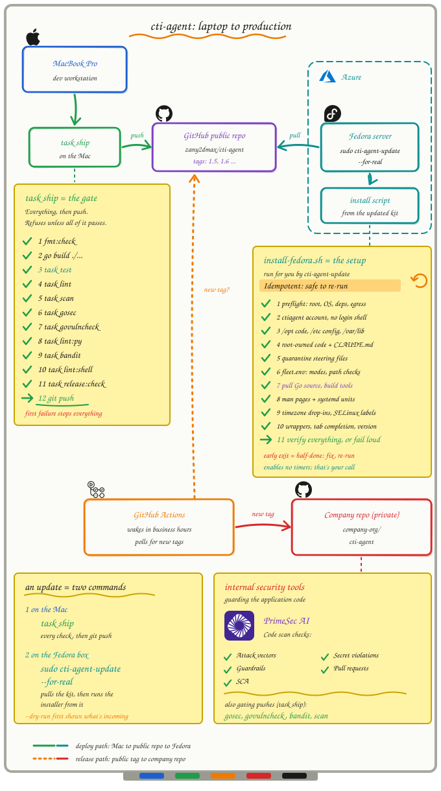

# CTI Agent Fleet

**An always-on junior analyst for a security team.** Every morning it reads the
advisories, asks your scanner which of those CVEs are *actually on your
machines*, and chases the open tickets. Every week it checks your web
applications and your domains, and confirms the vulnerability scans ran and
reach every network on the network team's spreadsheet. Every month it measures Patch Tuesday against
your estate. It has no sick days, no vacation and no Friday afternoon, and it
never says "all clear" about something it did not check.

**What lands in your inbox**

- A ranked daily digest of what is really exposed, with CISA KEV deadlines.
- A daily report to each web application's owner: the scanner's own report of
  what is open on it, by email. Most owners are outside the company or have no
  Jira login, so the results go to them directly, not into a ticket.
- A weekly web-application report for the developers: open findings per
  application, what is new, and whether each scan logged in.
- A weekly vulnerability-scan report: that every scheduled scan ran, what
  each covered, and which of the network team's subnets no scan reaches.
- The exact DNS changes IT needs to make, filed as a single ticket.
- A monthly Patch Tuesday synopsis, built from Microsoft's own data.

**Why you can trust it.** Every claim comes from the system that owns it:
presence only from the scanner, registration only from the registrar, a
release's contents only from Microsoft. The report says plainly what it could
not check, because a report that cannot tell "we looked and found nothing" from
"we never looked" will publish the reassuring one. The reports are written by
plain, deterministic code. AI only supervises: the orchestrator that watches
the lanes can read and escalate, and is not given the runners or the mailer.
Email goes only to allowlisted audiences, tickets only to an allowlisted
project, and anything else waits for a person's approval. It does the legwork;
people make the calls.

**Built to be reused.** Each chore is a *lane*: a small program on a systemd
timer that gathers facts, decides what matters and writes it up for the right
people. Today's lanes are threat intel, Jira follow-through, Patch Tuesday,
application security, vulnerability-scan coverage, domains, and housekeeping. Adding a lane for the next
tedious thing is the point: [AGENT-FLEET-PATTERN.md](AGENT-FLEET-PATTERN.md) is
the recipe. It works with Qualys, Jira, Microsoft 365 and GoDaddy today, and
the scanner, registrar and ticketing tool sit behind swappable Go interfaces:
[INTERFACES.md](INTERFACES.md) shows where to plug yours in. Standard library
only, no dependencies, one box. It started as a counter-threat-intelligence
digest, which is where the name comes from.

---

## Documentation map

| If you want to… | Read |
|---|---|
| **explain it to someone in one page** — each lane, when it runs, whether it uses AI | **[LANES.md](LANES.md)** |
| **understand what this is and why, in two pages, with diagrams** — start here | **[ARCHITECTURE.md](ARCHITECTURE.md)** |
| **get it running**, from empty checkout to a box that mails every morning | **[RUNBOOK.md](RUNBOOK.md)** |
| **check it is up and working** from an SSH session: health, version, timers, dry runs, logs | **[CHEATSHEET.md](CHEATSHEET.md)** — `task cheatsheet:pdf` prints it to `CHEATSHEET.pdf` |
| understand *why* it is shaped this way — orchestrator, executor lanes, heartbeat, message board, persistent memory | **[AGENT-FLEET-PATTERN.md](AGENT-FLEET-PATTERN.md)** |
| the full fleet reference: every command, every setting, the schedule, troubleshooting | **[fleet-kit/README.md](fleet-kit/README.md)** |
| **see what is planned**, and what is only an idea | **[BACKLOG.md](BACKLOG.md)** |
| **swap in a different scanner, registrar or ticketing tool** - every Go interface the fleet is built on, how complete each one is, and where new ones could go | **[INTERFACES.md](INTERFACES.md)** |
| **see how the model-driven parts are run and checked** - the agent harness the check-in already has, and the missing pieces (beat traces, evals, a structured verdict) | **[HARNESS.md](HARNESS.md)** |
| **one command's every flag, environment variable, file and exit code** | **[man/man1/](man/man1/)** — `man cti-domains` on the box; `man ./man/man1/cti-domains.1` in a checkout. Conventions: [man/STYLE.md](man/STYLE.md) |
| know what the always-on orchestrator is allowed to do, and what it must never do | [fleet-kit/fleet/CLAUDE.md](fleet-kit/fleet/CLAUDE.md) |
| the individual agent playbooks | [skills/](fleet-kit/fleet/skills/): [checkin](fleet-kit/fleet/skills/checkin/SKILL.md), [cti-digest](fleet-kit/fleet/skills/cti-digest/SKILL.md), [scout-sweep](fleet-kit/fleet/skills/scout-sweep/SKILL.md), [patch-tuesday](fleet-kit/fleet/skills/patch-tuesday/SKILL.md) |
| advisory triage's two agents: the reader (sees only the advisory) and the judge (sees only the Falcon facts) | [triage-reader/CLAUDE.md](fleet-kit/fleet/agents/triage-reader/CLAUDE.md), [triage-judge/CLAUDE.md](fleet-kit/fleet/agents/triage-judge/CLAUDE.md) — live in the daily digest with `TRIAGE_ENABLED=1`. The earlier single-agent design against an org profile, [agents/triage/](fleet-kit/fleet/agents/triage/), is superseded and not invoked |
| **the threat model** — trust boundaries, why the AI triage agent is separate and has no tools, credential handling, the send gate, known gaps | **[SECURITY.md](SECURITY.md)** |
| **know what changed and what an upgrade asks of you**, and how to ask a deployed box its version | **[CHANGELOG.md](CHANGELOG.md)** |
| see what a report looks like before running anything | [examples/sample-report.md](examples/sample-report.md) |

Quick jumps into the runbook: [Entra app
registration](RUNBOOK.md#1-microsoft-entra-app-registration) ·
[configuration](RUNBOOK.md#4-configuration) · [the two-box
workflow](RUNBOOK.md#7-the-two-box-workflow-mac-to-fedora) · [enabling
timers](RUNBOOK.md#9-enabling-the-timers-in-order) · [verifying a
run](RUNBOOK.md#12-verifying-a-run) · [taking a host off the
schedule](RUNBOOK.md#11e-taking-a-host-off-the-schedule) · [known
gaps](SECURITY.md#known-gaps-and-accepted-risks)

**From laptop to production.** Every push passes the `task ship` gate, the
server installs idempotently, and each release tag is copied to the company
GitHub for scanning (the gates are described in
[SECURITY.md](SECURITY.md#build-and-release-gates)):

---

## What it produces

**A daily digest.** Reads the mailbox, extracts CVEs, asks the scanner what is
present, enriches with NVD CVSS, EPSS and CISA KEV, prioritises Sev5–Sev1, and
mails an HTML digest with the exploited-and-present findings at the top. A
FLEET TICKETS section lists every ticket any lane has filed (open, and those
closed in the last 30 days): each CVE ticket with its status, the hosts the
scanner sees today and what that morning's re-check did; the domains lock-down
and VM scan spreadsheet tickets with their status; and one line counting the
supplier requests opened for TPRM evaluation.

**A monthly Patch Tuesday synopsis.** Reads Microsoft's own release data,
cross-checks it against BleepingComputer (and the Qualys blog when it can be
read), correlates the release against Host Detection, and answers the question
neither public write-up can: what landed on *our* machines. One table row per
QID, the Qualys Detection Score, and the Qualys review's own QQL verbatim (when
the review was read) so somebody can paste it into the console and see the
same set. **Run by hand for now:** both article sites refuse the server, so the
operator saves the two articles into the release's inbox folder and starts the
run ([CHEATSHEET.md](CHEATSHEET.md) section 7a); the timer stays disabled.

**A weekly AppSec report.** Fridays, to a separate list — the people who own
application code, not the people who patch servers, and the split is enforced
in code. Built from the DAST scanner's own scan-completion mail (Qualys WAS
today, any scanner behind `internal/appscan`) plus its API for per-finding
detail. Open counts per application, what is new since the last scan, and a
label on every count saying whether that scan logged in. A scanner credential
that stops working alerts the operator rather than the developers. It files
no Jira tickets: the owners get their results by email (below). Per-application
tickets still exist for a site that wants them (`WAS_TICKETS=1`, off by
default): one per application, assigned to its owner, with the scanner's fix
text, the scanner's unconfirmed Critical and Urgent findings in a "please
verify" section, and optionally the scanner's own report attached
(`WAS_ATTACH_REPORT=1`).

**Daily application-owner reports.** Each morning, for every web-application scan
that finished since the last run, the application's owner (and watchers) get the
scanner's own report of what is open on it, by email, with the scan account's
session removed. Many owners are outside the company and have no Jira login, so
this is email and not a ticket. A scan that did not finish, whose login failed or
that reached no host is held back and the operator is told; one Qualys finished
with service errors is sent, marked as possibly incomplete. Off until an
allowed-domain list is set; who may receive it is decided in the mailer, not in
the runner. The owners list stays in step with the scanner: `fleet-owners sync`
asks Qualys for every web application, reports each one with no owner, and
applies only the changes that follow from owners already on file.

**A weekly vulnerability-scan report.** Mondays, to the vulnerability-management
audience (and the network and M&A teams if you add them).

- **Which scans ran comes from Qualys itself.** The lane lists the week's VM
  scans and their Asset Groups through the Qualys API, and every scan schedule,
  so an active schedule that launched nothing is reported by name, and a
  switched-off one is named as such. Each scan's "Scan Results" notice is
  matched by scan reference for its host counts; a scan whose notice was lost
  in the mail is still reported and still counts. Nothing has to be kept in step
  when a scan is renamed (`VMSCAN_SCANS` only adds titles). It carries no
  severity counts, on purpose.
- **The coverage check** compares the network team's spreadsheet of subnets
  (read through Microsoft Graph) with the Asset Groups the scans targeted, by
  address. Each site's network is its 10.X.30 range inside the site's /16,
  whatever the row is labelled, else its `corp` row; `netrules.txt` decides
  where the sheet is unclear. A site is closed only when its header starts with
  DECOMMISSIONED. It lists the networks no scan reaches (the lane records only
  that, and asks the network and M&A teams to say why), the rows the check
  cannot read, clean-up the sheet needs (overlapping networks, rows outside
  their block, a public IP under two sites, header problems, and the
  operator's cross-check notes in `sheet-notes.txt`), and anything odd in
  Qualys: a scanned group that is only closed sites or is not in the sheet, and
  every Asset Group no scan targeted. The findings also come as a CSV worksheet.
- **The network team's ticket.** The rows to correct and the clean-up go to the
  help desk as one Jira ticket, unassigned, for the network team (`cti-jira
  --vmscan-fixes`): filed when none is open, commented on only when the list
  changes, told once when nothing is left, and listed in the Daily Brief's
  FLEET TICKETS.

Everything it reads (Graph, the Qualys VM API) is read-only; the only write is
the ticket, behind `JIRA_ALLOW_CREATE`. A scheduled scan that did not run leads
the email. `cti-vmscan --check` tests every input: the Graph token, the sheet,
the Asset Groups, the scan list and the schedules.

**A weekly domains check.** Tuesdays, security team only. For every domain in an
operator-maintained inventory (`/etc/cti-agent/domains.txt`, never in this
repository): still registered in the GoDaddy account, and is the account
holding domains nobody listed (INVENTORY vs GODADDY); which domains have a live
website (WEBSITES); does the certificate verify; and do the mail records match
the domain's row in the security team's decision chart, chosen by markers in
the inventory (`send`, `receive`, `saas`, `unknown`, `legacy`; no marker means
no mail at all) — a sender needs SPF, DKIM and an enforcing DMARC, a domain
with no mail must publish `v=spf1 -all`, `p=reject` and a null MX so nobody can
send as it. The difference is listed as DNS CHANGES FOR IT and filed as one
Jira lock-down ticket per run. Then what changed since last week. A failed DNS
lookup is reported as *not checked*, never as a missing record.

**KEV deadline tracking.** CISA remediation deadlines, but only for CVEs the
scanner actually found in the estate — a deadline for something you do not have
is noise.

**A tidy mailbox.** Mail the lane that owns it has read goes to Archive (CTI
advisories after the digest, Qualys WAS scan notices after the AppSec weekly),
automatic replies to Deleted Items, and *everything else is left exactly where
it is.* Qualys's companion notices (the "scheduled to start" mail before a
web-application scan, the "Scan Completed" mail after a VM scan) go to Deleted
Items once the lane that used the scan's results has sent its report. The mail
filter's "End User Digest" goes to Deleted Items too, unless it lists held mail
from a sender the fleet reads; then it stays for seven days and the operator is
alerted (the fleet never follows a digest's Release link). Archiving no longer
waits for a CVE: a quiet day archives like any other.

**Noise when something breaks.** A failed unit emails the operator and posts to
the message board, because the whole premise is that a quiet inbox means a
quiet day — which only holds if a broken pipeline is loud.

**An audit trail.** Every mail sent or moved, every Jira write and every change
to the application owners is written as one RFC 5424 syslog line to
`/var/log/cti-agent/audit-YYYY-MM-DD.log`, so any SIEM can read it unchanged.
Message bodies, ticket text and credentials are never written. Forwarding to a
collector is optional (`AUDIT_SYSLOG_ADDR`); no SIEM is bundled, and the local
files are a record, not tamper-proof evidence. See
[SECURITY.md](SECURITY.md#the-audit-trail),
[RUNBOOK.md](RUNBOOK.md#11l-the-audit-trail) and `man cti-audit`.

---

## The design pattern

If you want to understand *why* this is shaped the way it is — what an
orchestrator, executor lanes, a heartbeat, a message board and persistent
memory each contribute, and how they compose into something that does a job
rather than runs a task — read
**[AGENT-FLEET-PATTERN.md](AGENT-FLEET-PATTERN.md)**.

The pattern originates with [Build Your Own Claude Code Agent
Fleet](https://www.limitededitionjonathan.com/docs/build-your-own-agent-fleet)
by Limited Edition Jonathan. This repository applies it to an information security 
team's needs.

---

## Two ways to run this

**The agent alone.** Build it, point it at a mailbox, get a markdown report. No
systemd, no service account. [RUNBOOK → The agent
alone](RUNBOOK.md#5-the-agent-alone).

**The agent inside the fleet** (`fleet-kit/`). An always-on orchestrator plus
executor lanes that add exploitability context, prioritise Sev5–Sev1, render the
HTML digest and mail it on a schedule. [RUNBOOK → Installing the
fleet](RUNBOOK.md#8-installing-the-fleet), and
[fleet-kit/README.md](fleet-kit/README.md) for the complete reference.

---
