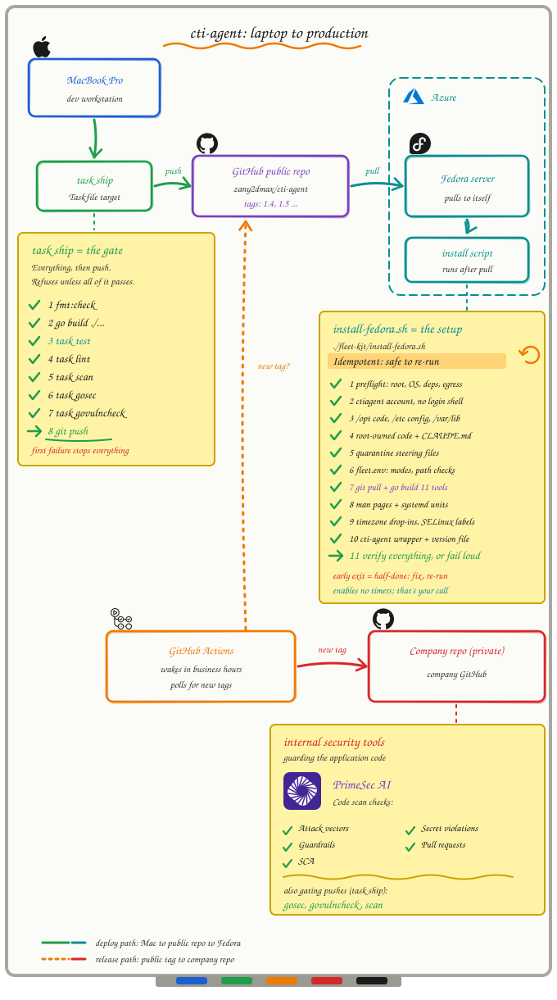

# SECURITY

The threat model, trust boundaries and security-relevant design decisions for
this repository.

This file is longer than a disclosure policy because the system it describes —
a fleet of scheduled lanes doing a security team's routine chores — holds
credentials to a mail tenant and a vulnerability scanner, writes a
document that names exploitable machines, modifies a shared mailbox
unattended, and is being extended to pass attacker-authored text to a model.
Each of those deserves an explicit answer rather than an assumption.

Sections describing work that is designed but not built are marked as such.
A threat model that claims controls it does not have is worse than none.

- [Reporting a vulnerability](#reporting-a-vulnerability)
- [What this system handles](#what-this-system-handles)
- [Trust boundaries](#trust-boundaries)
- [The supplier-request lane: untrusted mail reaching a model with no tools](#the-supplier-request-lane-untrusted-mail-reaching-a-model-with-no-tools)
- [AI triage: untrusted input reaching a model with tools](#ai-triage-untrusted-input-reaching-a-model-with-tools)
- [Data sensitivity: the report is a targeting list](#data-sensitivity-the-report-is-a-targeting-list)
- [Credentials and secrets](#credentials-and-secrets)
- [Microsoft Graph permissions](#microsoft-graph-permissions)
- [The send gate](#the-send-gate)
- [Autonomy gates](#autonomy-gates)
- [Mailbox modification](#mailbox-modification)
- [Supply chain](#supply-chain)
- [Host hardening](#host-hardening)
- [Build and release gates](#build-and-release-gates)
- [Output handling](#output-handling)
- [Failure philosophy](#failure-philosophy)
- [Known gaps and accepted risks](#known-gaps-and-accepted-risks)
- [If you are deploying this yourself](#if-you-are-deploying-this-yourself)

---

## Reporting a vulnerability

Open a GitHub security advisory on this repository, or contact the maintainer
privately. Please do not open a public issue for anything exploitable.

Include what you did, what happened, and what you expected. A proof of concept
is welcome but not required.

---

## What this system handles

Four things, each with a different worst case:

| Asset | Worst case if it leaks or is abused |
|---|---|
| Entra app credentials (`CLIENT_SECRET`) | read, and depending on grants send and move, mail across a tenant |
| Qualys API credentials | read access to the organisation's complete vulnerability posture |
| Generated reports | a list pairing "this CVE is exploitable" with "these machines have it" |
| The shared CTI mailbox | a security team's reporting inbox, read by several people |

The reports are the asset people underestimate. They are not a summary of
public advisories; they are the intersection of public exploitability with
private asset inventory, which is precisely a targeting list.

---

## Trust boundaries

Everything crossing into this system from outside is untrusted, and the
degrees differ:

| Input | Source | Trust | Handling |
|---|---|---|---|
| CTI advisory emails | third parties, via a shared mailbox | **untrusted** | parsed for indicators; HTML escaped before rendering; never executed |
| Microsoft Security Update Guide (CVRF API) | public internet | **untrusted but reputable** | the Patch Tuesday lane's primary source; parsed as JSON, values escaped |
| Vendor wrap-up pages (Qualys blog, BleepingComputer) | public internet, or a copy the operator saved in a browser and dropped into `inbox/patchtuesday/YYYY-MM/` | **untrusted** | fetched over HTTPS or read from the drop folder, parsed, escaped. A saved copy is the same third-party HTML, not operator-trusted input |
| NVD, EPSS, CISA KEV | public internet | **untrusted but reputable** | parsed as JSON, values escaped |
| Qualys API responses | our scanner, over the network | **semi-trusted** | XML parsed; host names treated as sensitive output |
| Microsoft Graph responses | our tenant | **semi-trusted** | message bodies are third-party content and stay untrusted |
| `fleet.env` | the operator | **trusted** | it holds the credentials; whoever can write it already controls the process |
| Environment from systemd | the host | **trusted** | same reasoning |

The consequence worth stating plainly: **an email body is attacker-controlled
input.** Anyone can send mail to a published security address. Every design
decision downstream of the mailbox assumes the sender is hostile.

---

## The supplier-request lane: untrusted mail reaching a model with no tools

The first live use of a model on untrusted input is the supplier-request lane
(`run-supplier`), and it is built to the narrowest version of the design below:
the model has **no tools at all**. Each request is passed on stdin to
`claude -p` started with `--tools ""`, `--strict-mcp-config`,
`--no-session-persistence` and project-only settings, from an empty work
directory. It cannot read, write, run or send anything; it returns one JSON
object. The standing instructions are root-owned
(`/opt/cti-agent/agents/supplier/CLAUDE.md`), and the sender, subject, form and
text are all inside an untrusted block whose markers are removed from hostile
text.

What code does with the answer is the control. `cti-supplier` parses it
strictly, requires every quoted line to appear in the request, and can **only
move an answer toward Unsure**: a No is refused when the form was not read, when
the name or notes hold a technology word, or when the request tried to steer the
reader, and output code cannot use is Unsure. An attacker who fully controls the
request can therefore make the lane ask a person; they cannot make it say No.
The attachments the lane may open are `.xlsx` forms only, by a policy that
refuses names like w9, bank, routing, void, tax, irs and ach, so the scanned tax
and bank files are never fetched. The lane never replies to a requester and
never moves mail itself. It records the messages of a request it has dealt with
(judged not critical, or critical or unsure with its Kanban item filed) in its
own log, and the daily mailbox cleanup files those in Archive after its usual
grace, as it does for the other lanes' mail. A request set aside as not a
supplier request is never recorded, so a person's question to the team stays in
the inbox, and so does a request whose item could not be filed.

The `claude` flags above were exercised against the real CLI in a dry run on the
box (20 requests judged, none failed), and the model evaluation (`task
eval:supplier`) runs the same arguments.

## AI triage: untrusted input reaching a model with tools

> **STATUS: DESIGN. NOT YET IMPLEMENTED.**
> No code in this repository does any of what this section describes. It is
> written down before the build so the trust boundaries are agreed first, and
> so that a later change cannot quietly hand the analysis agent a capability
> this section rules out. Read every "must" below as a requirement on work not
> yet done, not as a description of a control that exists.

This is the newest and sharpest boundary in the system, and the one most
likely to be got wrong by a well-meaning change. The agent's standing
instructions are written and reviewable at
[`fleet-kit/fleet/agents/triage/CLAUDE.md`](fleet-kit/fleet/agents/triage/CLAUDE.md);
the organisation profile it reads to judge relevance is a hand-written
template at
[`ORG-PROFILE.md`](fleet-kit/fleet/agents/triage/ORG-PROFILE-TEMPLATE.md) — the
template is in the repository, the filled-in copy lives only at
`/etc/cti-agent/ORG-PROFILE.md` and is gitignored — and is
deliberately categories rather than inventory, because the repository is
public.

### The problem

CVE-keyed automation misses a large fraction of real threat intelligence.
A representative daily roundup from a commercial feed contained seven items;
**four carried no CVE at all** — an autonomous-agent campaign against
retailers, a rogue-MFA-provider technique against Entra ID, a claimed
zero-day with no assigned identifier, and a malicious package. A pipeline
that keys on `CVE-\d{4}-\d{4,}` sees none of it.

Fixing that with per-sender template parsers fails two ways: it is a treadmill
against every new feed, and a template that stops matching returns zero items,
which is indistinguishable from a quiet day. So the analysis is done by a
model, which needs no template and handles a one-off warning from a peer as
well as a formatted roundup.

That means **text written by an unknown third party is passed to a model.**
If that model has tools, the content is trying to use them.

### Why a separate agent, not the orchestrator

The fleet already runs an orchestrator agent on a heartbeat. It would be the
convenient place to put this. It is the wrong place.

The orchestrator holds the most authority in the fleet: it writes the message
board, escalates to the operator, spends the model budget, and invokes the
mailer. Handing attacker-authored content to the component with the most
privilege inverts least privilege.

The analysis agent must therefore be **separate, with its own standing
instructions and its own — much smaller — set of permissions**:

| | Orchestrator | Analysis agent |
|---|---|---|
| Read the mailbox | yes | **no** — it is handed a prepared file |
| Send mail | via the mailer | **no** |
| Write the message board | yes | **no** |
| Shell / arbitrary commands | limited | **no** |
| Network access | yes | **no** |
| Filesystem | fleet state | **one input file, one output file** |

If the analysis agent is fully subverted by a crafted advisory, the worst case
must be a wrong JSON document, validated by code that does not trust it.

This is not hypothetical. The campaign that prompted this design documents the
attackers running a purpose-written skill to strip their own harness's content
filters, and falling back to an older model after newer ones refused. The
defence cannot be "the model will decline."

### Deterministic floor, model ceiling

Code does the extraction and keeps the trust boundary. The model does the
judgment. Neither substitutes for the other.

**Floor** — regex over stripped text, always runs, no model: CVE IDs, MITRE
technique IDs, defanged indicators, links, counts. If everything else fails,
the digest still reports *that* non-CVE intelligence arrived and what raw
artifacts it contained. Today only the CVE half of this floor exists, in
`internal/cti`; the rest is unbuilt.

**Ceiling** — the model: how many distinct items, what each is about, and
whether it plausibly matters to this organisation.

A model that is unavailable, rate-limited, timed out, or returning malformed
output degrades to the floor **and says so in the output.** The digest never
waits on it and never fails because of it.

### Four controls that make non-determinism acceptable here

1. **The model must annotate, never gate.** Every non-CVE item reaches the
   digest regardless of what the model concludes about it. A model deciding
   something is irrelevant, and being wrong, must not be able to make it
   disappear. Suppression must not be a capability the analysis agent has.

2. **Output must be verified against the source text.** Every indicator the
   model reports must appear verbatim in the message it was given, or be
   dropped and flagged — that kills hallucinated indicators. Every indicator
   the regex floor found that the model omitted must be reported anyway — that
   kills silent omission. The model must be unable to add facts or quietly
   remove them.

3. **Output must be schema-validated.** Anything that does not parse is a lane
   failure, reported as such. It must never be treated as an empty result.

4. **Output must be escaped on render**, the same as every other third-party
   string that reaches an email from this system.

### Instruction-injection posture

Content from the mailbox must be delivered to the agent as **data inside a
delimited block**, with standing instructions that text within it is evidence
to be analysed and never instructions to be followed. That is a mitigation,
not a guarantee — which is why it is the *fourth* line of defence, behind
having no tools to hijack, no ability to suppress, and mechanical verification
of the output.

If a future change gives the analysis agent a tool, the question to answer
first is: *what does a crafted advisory make that tool do?*

---

## Data sensitivity: the report is a targeting list

A generated report pairs exploitability with named machines. Treat it as such.

- Written mode **0600** by the Go commands — reports, state files, manifests
  and the processed-message log, with tests asserting the mode.
- Excluded by `.gitignore` — `reports/`, `digest-*.html`, `enriched-*.json`,
  `*-vuln-report.md` and others.
- Mailed only to addresses on an allowlist.
- Carries a "do not commit" banner when it contains real hostnames.

**The Python lanes rely on the unit's umask.** `brief.py` and `enrich.py`
write the digest HTML, the digest text and `enriched-*.json` — which carries
host names — with a bare `open(path, "w")` and no `chmod`. Every service unit
now sets `UMask=0077`, so those land `0600` too. Run a lane outside systemd
and it inherits your shell's umask instead, which is worth remembering when
replaying by hand.

**The AppSec report is the same kind of document for our web estate.** It names
which applications have open Urgent findings, and for new ones the vulnerable
URL and parameter. Same handling: written `0600` by `cti-appscan`, kept under
`state/`, mailed only through its own allowlist (below). Its test fixtures are
**synthetic** for the same reason — real scan titles and targets enumerate our
applications and say which are scanned without a login, and this repository is
public.

**Evidence on tickets is bounded and scrubbed.** The open-findings search is
verbose, so each finding carries its request, payload, access path and a
response excerpt; request headers are never read. `Redact()` removes `Cookie`,
`Set-Cookie`, `Authorization` and similar header values wherever they appear
in a line, and token-named JSON values; `RedactURL()` blanks URL parameters
named like a session or credential (`token=`, `sid=`, `;jsessionid=`, ...) in
every URL a ticket shows; a base64 response that does not decode to readable
text is dropped rather than passed on unchecked. Every field is clipped, the
attachment carries evidence for at most 10 places per finding, and the proof
is shown in a Jira `{noformat}` block so a response cannot become markup.
Redaction is by pattern: a secret in an unrecognised form can still get
through, which is one more reason the tickets' audience matters.

**The scanner's own report is more sensitive still, and is short-lived.** With
`WAS_ATTACH_REPORT=1` the AppSec lane fetches Qualys's per-application report
(`cti-appreport`) and attaches it to the application's Jira ticket. That report
holds the request and response behind each finding, which includes **the scan
account's session cookies**. So it is: written `0600` in a directory created
`0700`; deleted from Qualys immediately after download; deleted from local
state by `run-appscan` once `cti-jira` has attached it; fetched only for
tickets about to be filed or commented; and off by default. The ticket says it
is attached and that it contains cookies, so whoever opens it knows. The
rehearsal ticket (`cti-jira --appscan-test`) is unassigned and untracked by
state, but still attaches the cookies-bearing report: delete it in Jira, and the
local copy, when done. The
attachment is visible to everyone who can see the Jira project, so the
scan account should be a dedicated, low-privilege test login whose sessions are
cheap to expire. `cti-appreport --probe-findings` prints raw finding fields for
testing; `Redact()` strips `Cookie`, `Set-Cookie` and `Authorization` values from
that output, but the rest is still evidence from our own application, so it is
redirected to a `0600` file and kept off tickets.

**A stand-in scan is reported as a stand-in.** Where a staging copy is scanned
instead of production (`covers=` in `app-owners.txt`), the report says
"covered via staging - production not scanned directly", never "scanned": a
staging scan tests the code, not production's edge, WAF, TLS or headers. The
mapping, like the owners, lives only in `/etc/cti-agent`. RUNBOOK 11f recommends
password-protecting such staging copies and adding a non-intrusive scan of
production.

**Ticket watchers are best-effort and need one more Jira permission.** An
optional `watchers=` field in `app-owners.txt` (max 10 emails, file outside the
repo) makes `cti-jira` add each as a watcher on the application's ticket. That
needs "Manage watcher list" on the Jira API account (plus "Browse users and
groups" for the lookup). A watcher that is not found, invalid or refused is
logged and skipped; it never blocks a ticket, and watchers are not put in the
weekly email.

**Recurring-ticket links are best-effort and need "Link issues".** A new
application ticket is linked ("Relates") to that application's last closed
ticket. A failed search or a refused link is logged and skipped; the ticket is
still filed.

**The domains check is a target list, and its input never enters the
repository.** The report names every domain we own and which of them can be
spoofed or taken over; the inventory says which ones send mail. So the
inventory is an operator file (`/etc/cti-agent/domains.txt`, `root:ctiagent`
0640, the same rule as `ORG-PROFILE.md`), `domains.txt` is gitignored and a test
fails if one appears in the tree, the report and `domains-state.json` are
written `0600`, it goes only to `DOM_TO` through its own fail-closed allowlist,
and every fixture is a reserved example name.

**The mail-gateway read is aggregates only, read-only, and a failed read holds
tickets rather than guessing.** With `DOMAINS_MAIL_GATEWAY=pod` the domains lane
reads the Proofpoint on Demand log for the last N days and keeps header-From
domain counts and DMARC pass/fail counts: no address, subject, recipient or
message is stored or printed, and the client makes no write to the service.
The token comes from `fleet.env` only and is the fleet's own (one session per
token). If the read fails or is incomplete the lane does not assume a "sends
nothing" domain is silent: it produces no lock-down actions, marks the actions
file held, and `cti-jira` files, comments and resolves nothing that run. Off
unless the setting is made.

**The GoDaddy token can read, and the client never asks for auth codes.** The
listing endpoint will return each domain's transfer auth code on request; a
file or log holding those for every domain we own would be the most valuable
thing on the box. The client requests `nameServers` and nothing else, makes no
non-GET call, and a test fails if either changes. Grant the PAT
`domains.domain:read` only.

`REPORT_HOSTNAMES` controls disclosure:

| Value | Output |
|---|---|
| `full` *(default)* | real hostnames |
| `redact` | stable pseudonyms. Irreversible only **with** `REPORT_REDACTION_SALT` set — see below |
| `count` | host counts only |

**The default is `full` deliberately**, and the reasoning is worth keeping:
a pseudonym cannot be looked up in the scanner, so a redacted report says a
critical finding exists without saying where, and somebody has to rerun the
pipeline to act on it. An unactionable security report is not a safe security
report. The controls that make that defensible are the file mode, the
gitignore and the allowlist — not obscurity.

**Set `REPORT_REDACTION_SALT` if you use `redact`, and treat it as required
rather than optional.** The salt has no default. Without it a pseudonym is an
unsalted truncated hash of the host name, which anyone holding a list of
candidate names can confirm by hashing them — and corporate naming schemes are
small enough to brute-force. The report prints a warning banner when the salt
is unset, but the pseudonyms in it are not meaningfully protective.

---

## Credentials and secrets

- All credentials live in one file — `fleet.env` in production, `.env` in a
  checkout — never in code, never in systemd unit files, never in arguments.
  Both names, and anything else ending `.env`, are gitignored. That gap was
  real until recently: only `.env` was listed, so a `fleet.env` copied into a
  checkout to replay a run locally could be committed.
- `internal/fleetenv` is the single reader for the Go commands, and the
  `cti-agent` wrapper loads `fleet.env` as the service account before any hand
  run (the Python lanes and `fleet-db` included), so a run by hand gets the
  same configuration as a run by systemd, and there is one place to audit. A lane
  test fails any command that loads config without calling it (`cti-domains`
  calls it before its flag defaults are read, so `DOMAINS_FILE` applies to a
  run by hand too): `cti-appscan` shipped without, and worked under its timer while failing by hand with
  "missing required environment variables" on a box where all were set.
- **The Qualys credentials now reach a second module.** The AppSec lane uses
  the VM lane's `QUALYS_USERNAME`/`QUALYS_PASSWORD` against the WAS API, which
  needs the WAS module on that account's role. It issues **search requests
  only** - it never launches a scan, edits a web application or touches an
  authentication record - with one optional exception: `cti-appreport`
  (`WAS_ATTACH_REPORT=1`) creates a WAS report and deletes it again, so it
  needs the permission to create reports. Leave the feature off and the role
  needs read access to WAS only. Its Qualys API calls share the subscription's
  rate limit, which `internal/qualysrl` reads from the response headers and
  respects, leaving `QUALYS_RL_RESERVE` calls for the VM lane.
- **Jira: a scoped token on a service account is the least-privilege option.**
  Optional `JIRA_CLOUD_ID` sends API calls through
  `https://api.atlassian.com/ex/jira/<cloud id>`, which an Atlassian scoped API
  token requires. Use a service account (not the organisation Settings > API
  keys page, whose `:admin` scopes administer the organisation) with exactly
  three classic scopes: `read:jira-work`, `write:jira-work`, `read:jira-user`.
  No delete, transition or admin scope is granted because the fleet never
  deletes or moves a ticket. The value must be a UUID, so the credentials can
  only be sent to `api.atlassian.com` and never to a host an edited
  `fleet.env` names. Tokens expire within 365 days. `cti-jira --check` reports
  each permission as ok or MISSING without writing anything.
- **`CLIENT_SECRET` also keys the self-sent header signature** (below,
  Mailbox modification). Rotating it is still the right response to exposure;
  the cost is that fleet mail already in the inbox stops verifying and is
  left for a human instead of archived.
- **No default mailbox and no default recipient.** An unconfigured install
  refuses to start rather than guessing an address.
- Each command validates only the credentials it uses, so a missing-variable
  error names things that are actually required.
- On Fedora the installer relabels for SELinux. A `fleet.env` staged in a home
  directory and moved into `/etc` keeps its original label and systemd cannot
  read it, which presents as every timer failing while manual runs work.

**Git history is permanent.** A credential committed once should be treated as
compromised and rotated, not deleted. `scripts/scrub-history.sh` exists for
rewriting history, but rewriting is remediation, not prevention — forks,
clones and caches may retain what was pushed. The scrub pattern file is itself
gitignored.

---

## Microsoft Graph permissions

Application permissions, each optional except the first. The first three are mail; the fourth is for one lane only:

| Permission | Needed by | Notes |
|---|---|---|
| `Mail.Read` | reading the CTI mailbox | not needed if you grant `Mail.ReadWrite`, which supersedes it |
| `Mail.Send` | sending digests and alerts | required by `mailer.py --check`; omit only if you want markdown reports and nothing else |
| `Mail.ReadWrite` | mailbox cleanup only | omit if you are not running that lane |
| `Sites.Selected` | the VM scan report's coverage check only | read access to ONE file (the network spreadsheet) through a per-site grant; omit and the check reports that it did not run. `Files.Read.All` or `Sites.Read.All` also work and are tenant-wide, so prefer the narrow one |

**Application permissions are tenant-wide by default.** `Mail.Send` means the
app can send as any mailbox in the tenant; `Mail.ReadWrite` means it can read
and move mail in any of them. Confine the app with an Exchange Application
Access Policy — or RBAC for Applications — **before** granting, not after.
The policy is scoped to the app, so it covers permissions added later.

**The VM scan coverage check reads one file and writes nothing.**
`graph.Client.DriveItemContent` downloads a single SharePoint file by its drive
and item ids, with a size cap, and reports a refusal as which permission to add.
Nothing in the fleet writes to SharePoint or to Qualys for this lane: the Asset
Group list is a read, and a Qualys account that cannot list groups only makes the
check say so. The spreadsheet is the network team's, so its cell text is treated
as untrusted data: it is HTML-escaped in the email, and in the CSV worksheet any
cell that starts with `=`, `+`, `-` or `@` is made inert so it cannot run as a
formula when the teams open it. The drive and item ids are tenant-specific and
live in `fleet.env`, never in the repository.

**Nothing in this codebase can permanently delete mail.** `internal/graph`
implements move-to-folder and nothing else; Graph's `DELETE /messages/{id}`
and the purge endpoints are deliberately absent. "Delete" means Deleted Items,
which is recoverable, and emptying that folder stays a person's job.

`mailer.py --check` decodes the token and reports which roles were actually
granted, including any that are consented but unused. Consent is the step
people skip, and an unused permission is standing risk with no benefit.

---

## The send gate

`VM_ALLOW_TO` is an allowlist enforced in code, not a convention:

- It covers **To and Cc**. Exempting Cc would make the control trivially
  bypassable — a header name does not change who receives the findings.
- A recipient outside it refuses the send and names the address.
- A one-off requires an explicit `--approve`.
- There is no default recipient anywhere in the system.

**Per-lane lists fail closed.** The AppSec report is sent with
`cti-mailer --lane was`, which resolves `WAS_TO` against `WAS_ALLOW_TO` and
refuses if **either** is unset, naming the variable. It does not fall back to
`DIGEST_TO` or `VM_ALLOW_TO`, and `--approve` does not override an empty
list — approval is for a one-off recipient, not for a missing control. This is
stricter than the original digest path, deliberately: a report about our
application code going to the server-patching list is a disclosure, not a
misconfiguration.

A list may reference another by exact name (`WAS_ALLOW_TO=$VM_ALLOW_TO,x@y`),
so a shared core is written once. Unset references are errors, cycles are caught
with a depth limit, and wildcard references (`$*_ALLOW_TO`, `${*}`) are refused
by name rather than expanded to whatever happens to match.

`cti-mailer --to-dev` is a development preview: it sends only to
`FLEET_DEV_EMAIL` from root-owned `fleet.env`, pre-approved the way the
operator's address is, never Cc'd, subject prefixed `[DEV TEST]`, and it
refuses to combine with `--lane`, `--to` or `--to-operator`. It cannot widen
who receives a report; it can only narrow it to one person.

The runners' `--to-dev` (`run-digest`, `run-patchtuesday`, `run-appscan`,
`run-domains`) routes their send through that same path and otherwise runs as
a dry run - no Jira writes, no sent record, no baseline, no board line - so a
test cannot make the real send skip as "already sent". `cti-alert --to-dev`
mails `FLEET_DEV_EMAIL` instead of the operator and posts nothing to the board
the orchestrator reads. Unset `FLEET_DEV_EMAIL` is refused before any work in
every case: there is no fallback to a real audience.

A dry run or test send of `run-digest`, `run-appscan`, `run-domains`,
`run-supplier`, `run-appowners`, `run-vmscan` or `run-patchtuesday` writes
nothing a real run reads. Its files go under
`$FLEET_HOME/dryrun/<lane>/`; the digest's ingest writes its own
processed-message log there (so a rehearsal never licenses mailbox cleanup to
archive mail) and `enrich.py` runs with `--no-db` (so `memory.db`, and the next
digest's "new" flags, are untouched); the supplier rehearsal's request text is
removed when it ends. Each lane also takes a lock (`state/locks/<lane>.lock`,
`flock(2)`): a rehearsal refuses (exit 75) while any run of the lane is active,
and a real run waits up to `FLEET_LOCK_WAIT_SECONDS` (default 600), then fails
rather than run beside another real one, or goes ahead past a rehearsal.

### There are two outbound paths, and only one is gated

`mailer.py` is the path for every digest and report, and it is gated as above.
No lane sends mail directly; the orchestrator invokes the mailer rather than
reimplementing it.

**`cti-alert` is the exception.** It calls Graph `sendMail` directly
(`cmd/cti-alert/main.go`), because the thing it reports on may be the mailer
itself — an alerter that depends on the component it alerts about is not an
alerter. It is **not** subject to `VM_ALLOW_TO`. Its recipient is
`FLEET_OPERATOR_EMAIL`, falling back to `DIGEST_TO`, and its body embeds up to
40 lines of `journalctl` output, which can contain host names, paths and
logged subjects.

Two consequences worth being deliberate about: set `FLEET_OPERATOR_EMAIL`, so
the fallback to the whole distribution list never happens; and treat alert
mail as carrying the same sensitivity as a report.

`run-appscan` is now a caller too: when a scanner credential fails it runs
`cti-alert --kind HOLD` with the **application names** in `--reason`. Not the
credential record or vendor status - those stay in the `0600` file under
`state/` - but the names alone say which of our sites a scanner can no longer
log in to.

---

## Autonomy gates

The orchestrator runs unattended. Its standing instructions
(`fleet-kit/fleet/CLAUDE.md`) prohibit, among other things:

- sending mail to anyone outside the allowlist, or adding to it
- `--for-real` on mailbox cleanup — the timer does that, not the agent
- `cti-patchtuesday --mark-sent`, which asserts an email reached people and
  causes the daily digest to suppress a release's CVEs
- creating or modifying tickets, scanner configuration, scans or exceptions
- deleting anything outside the log and archive directories
- anything touching a production host

Auto-sending is limited to scheduled reports on an established schedule to an
allowlisted list. Everything else is proposed on the message board and waits.

**Closing is a separate gate.** `JIRA_ALLOW_CLOSE` (project keys, empty = never)
is independent of `JIRA_ALLOW_CREATE` and, with `--for-real`, lets the weekly
AppSec run close the open ticket of a web app deleted from the scanner. It is
the only place the fleet changes a ticket's status. Guards: only when the
scanner's complete web-app list was fetched that run; only open tickets with the
labels `cti-appscan` and `cti-appscan-<numeric id>` that also carry the fleet's
state property (labels alone can be added by anyone who may edit a ticket); the
list must agree with that run's scans and the tickets file be under 24 hours
old; at most 3 per run and never most of the open queue (more closes none); a transition that needs a field other than resolution or
comment is refused. `--appscan-close-test` closes only a `cti-agent-test` ticket.

**The Jira write gate covers every write.** `cti-jira` writes nothing without
`--for-real` and a project key in `JIRA_ALLOW_CREATE`. Until 1.3 an empty gate
stopped new tickets only; comments, CSV attachments and stored exposure
properties went ahead. Every write is gated now, so with the gate closed the
daily follow-up and the domains lane's lock-down ticket run read-only. The
lanes that do write - `run-digest` (one ticket per KEV, Sev5, CVSS 9.0+ or QDS 91+ CVE) and
`run-domains` (one DNS lock-down ticket per run, commented on only when the
list changes) - are timer-owned and not on the orchestrator's grant.

### What the orchestrator may run

The heartbeat runs `claude -p` unattended, with `--permission-mode default`,
`--disallowedTools "Edit,Write,NotebookEdit"` and an explicit `--allowedTools`
list: named fleet commands by absolute path, `fleet-journal` (a wrapper, not
`journalctl`; see below), `fleet-timers` (a wrapper, not `systemctl`; see
below), and nothing else. Every Bash call also passes a PreToolUse hook,
`checkin-bash-guard` (below). It keeps
Claude Code's read-only file tools, limited to `Read` grants on `reports/`,
`logs/` and `archive/` under `$FLEET_HOME`.

**The beat cannot edit files, and will not run code it could edit.** A
PrimeSec scan found that the beat ran with `acceptEdits` (which auto-approves
file edits) while the generic installer left the fleet's runners and tool
policy owned by the service account. A beat that read a hostile advisory could
then have rewritten `run-checkin` or a granted binary, and every later run
would have executed the change with the fleet's credentials. Nothing in
`/checkin` writes a file - memory, tasks and board posts all go through the
granted commands - so the edit grant is removed, and `Edit`, `Write` and
`NotebookEdit` are disallowed by name so a later default change in Claude Code
cannot give them back. Separately, on Linux `run-checkin` exits 1 before it
posts to the board or starts claude unless it, its directory, `$FLEET_CODE`,
`$FLEET_CODE/bin` and each granted binary are root-owned, not group- or
world-writable, and not writable by the account running it. The unit's
`OnFailure` alert tells the operator. The generic installer is retired:
`install-fedora.sh` is the only installer, and it puts the code in
`/opt/cti-agent` as `root:root` `0755`.

**The beat's instructions and settings are root-owned too.** The code is not
the only thing a beat runs on: Claude Code also loads `CLAUDE.md`, skills,
`.claude/settings*.json` (allow rules and hooks, which are shell commands),
`.mcp.json` and `~/.claude.json` from its working directory and home. The beat
used to start in `/var/lib/cti-agent`, the service account's own home, where
the installer put `CLAUDE.md` and the skills owned by that account; an account
that owns a directory can replace anything in it, root-owned files or not. On
Linux the beat now starts in `/opt/cti-agent/orchestrator`, a root-owned
directory holding only `CLAUDE.md` and `.claude/skills/<name>/SKILL.md`, and
runs with `--setting-sources project` (nothing from `~/.claude`),
`--strict-mcp-config` with no server given, and
`--settings /opt/cti-agent/checkin-settings.json`, a root-owned `0644` file
that leaves hooks on with exactly one configured (the Bash guard, below),
disables bypass-permissions mode and denies `Edit`, `Write`, `NotebookEdit`,
`WebFetch` and `WebSearch`. The integrity check covers every entry of
`$FLEET_CODE/bin`, the settings file and the orchestrator directory, and the
beat refuses to start if `CLAUDE.md`, the `checkin` skill, the settings file or
the guard is missing.

**A steering audit refuses the beat if something has been planted.** A beat
steered once must not be able to leave a file behind that steers every later
one. Before each beat `run-checkin` looks for files Claude Code would load that
this fleet never installs: in the orchestrator directory, `.claude/settings*.json`,
`.mcp.json`, `CLAUDE.local.md` and `.claude/commands|agents|hooks|rules`; in
the service account's home and config directory, `CLAUDE.md`, `skills`,
`commands`, `agents`, `hooks`, `rules`, `output-styles`, `settings.local.json`,
`~/CLAUDE.md`, `~/CLAUDE.local.md` and `~/.mcp.json`; and keys in
`~/.claude/settings.json` or `~/.claude.json` that set hooks, permissions, MCP
servers, env, helper commands or plugins (and, per project, `allowedTools` or
MCP servers). Any hit exits 1 with an ERROR on the board and names the file.
On macOS the audit is reported, not enforced. `run-checkin --audit` runs the
integrity and steering checks without starting a beat, and the installer runs
it as the service account. On an existing box the installer moves the old
`/var/lib/cti-agent/CLAUDE.md`, `.claude/skills` and any planted Claude Code
files into `/etc/cti-agent/quarantine/<timestamp>/` (root-only; nothing is
deleted) and prints a diff hint if the old `CLAUDE.md` had operator edits.

**The journal goes through `fleet-journal`, not `journalctl`.** `journalctl
--cursor-file=PATH` writes `PATH` as the service account, so a grant of
`journalctl:*` let a steered beat overwrite `state/budget.json` (resetting the
quota that stops the fleet crowding out its owner) or `memory.db`; `--file`,
`--directory` and `--merge` widen what it can read. The grant is now
`$FLEET_CODE/bin/fleet-journal:*`, a root-owned wrapper that accepts only
`-u|--unit cti-agent-*`, `--since`, `-n|--lines` and `--no-pager`, passes each
as `--opt=VALUE`, and exits 2 on anything else.

**Timers go through `fleet-timers`, not `systemctl`.** The grant
`systemctl list-timers:*` could not become `stop` or `disable`, but it accepted
every global option after the prefix: `--host=user@box` runs the query over ssh
to any machine as the service account, and `--machine` reaches containers (H2
in the hardening review). The grant is now `$FLEET_CODE/bin/fleet-timers:*`, a
root-owned wrapper that accepts only `--all` and `cti-agent-*` patterns, passes
the patterns after `--`, defaults to `cti-agent-*`, and exits 2 on anything
else. `cti-alert` closed the same hole from its side: `--unit=--host=...` was
read by `systemctl` as an option, so it now refuses any unit that does not
match `^cti-agent-[A-Za-z0-9@._-]+$` (exit 2) and calls `/usr/bin/systemctl`
and `/usr/bin/journalctl` by absolute path, with the unit after `--`.

**Shell syntax is refused on every beat command.** A prefix grant such as
`fleet-timers:*` names the command, not the shell around it. If it ever matched
`fleet-timers > state/budget.json`, every grant would be an arbitrary file write
as the service account, and `cmd $(other)` would run something never granted.
Whether Claude Code's own matcher refuses each of those is its business; the
fleet no longer depends on it. `checkin-bash-guard` (`python3 -I`) is a
PreToolUse hook on Bash in the root-owned settings file, and exits 2 on any
command containing `<`, `>`, `|`, `;`, `&`, a backtick, a newline or CR, and,
outside single quotes, `$` (any expansion), `*`, `?`, `[` or `~`, or starting
with a `NAME=value` prefix. It finds the single-quoted spans by reading quotes
the way bash does, so a `'` inside double quotes is not mistaken for one, and it
refuses a backslash outside single quotes and an unbalanced quote, either of
which moves where bash thinks a quote ends. It also exits 2 on any input it cannot read: it
fails closed. `$` is refused even as plain `$NAME`, because the beat's
environment carries the `fleet.env` secrets, so `$CLIENT_SECRET` could reach the
board or a `cti-alert` mail. Single-quoted text is literal, so `'cti-agent-*'`
is fine; the beat types absolute paths, never `$FLEET_CODE`. A hook whose
command is missing fails open, and so does a guard whose python is missing, so
`run-checkin` refuses to start on Linux if the guard file is missing, if the
settings do not parse to `disableAllHooks: false` with a Bash PreToolUse command
hook at `$FLEET_CODE/bin/checkin-bash-guard`, or if piping a redirect payload
through the guard does not exit 2. A blocked call appears in the beat's log as a
`checkin-bash-guard:` line.

**The beat's arguments, reads and call counts are controlled too** (PrimeSec
design review 39260, Scenarios 222 to 224).

- *Argument policy (223).* A grant such as `cti-alert:*` names a command, so
  any arguments passed. `checkin-bash-guard` now holds a static table of what
  each granted command may take: subcommands, flags, values and lengths (board
  message 400 characters, memory text 1500, alert reason 800, printable ASCII
  only; `cti-alert` only `--unit cti-agent-checkin.service --kind ESCALATION`
  and exactly one of `--for-real` or `--dry-run`). A command not in the table,
  an unknown flag or an out-of-rule value exits 2. Brace expansion,
  parentheses and an unquoted `#` outside quotes are refused as well (bash and
  the guard read them differently). A test fails when `run-checkin`'s grant and
  the table differ.
- *Sanitizing (222).* Inside a heartbeat only (`CHECKIN_BEAT_ID` set),
  `fleet-journal`, `fleet-board read` and `tail`, all of `fleet-db`, `cti-kev`,
  `cti-mailbox`, `cti-patchtuesday` and `cti-alert` pass their output through
  `fleet-sanitize` (`internal/sanitize`): control characters (not newline or
  tab), C1 controls, every Unicode format character (bidi, zero-width, tag
  characters), line and paragraph separators and the Hangul fillers are
  removed, lines over 1024
  characters are cut with a `[cut N chars]` marker and output over 64 KB is
  cut. Each changed line is logged to the journal as `cti-sanitize`, never to
  stderr, which goes back to the model. Only standard output is cleaned: error
  text on standard error is not (accepted, as the commands' own error messages
  already pass `safelog`). Outside a beat nothing changes. If the cleaner is
  missing the beat gets nothing.
- *Limits and anomaly notice (224).* Each beat has an id; the guard counts its
  Bash calls in `state/checkin-counts/<id>.json` (not readable by the beat) and
  refuses calls past `CHECKIN_MAX_BASH` (20), `CHECKIN_MAX_ALERTS` (2),
  `CHECKIN_MAX_BOARD_WRITES` (4) and `CHECKIN_MAX_DB_WRITES` (6), logging a trip
  as `checkin-bash-guard`. After the beat `run-checkin` itself also checks the
  board's growth (`CHECKIN_MAX_BOARD_GROWTH`, 8 lines). Any trip posts a board
  line and a journal line; the second trip in a day emails the operator once
  (`cti-alert --kind HOLD`) and a third sends nothing more that day.

**Accepted gap.** The beat's Read grant on `reports/`, `logs/` and `archive/`
does not go through the wrappers, so what it reads from files is not cleaned.
This is accepted (decision of 2026-11-10): the beat has no write tools and no
mail address of its own, and every action it can take passes the argument
policy and the per-beat limits, so hostile text in a file can at most waste a
beat.

**The beat cannot empty the board or forge a line.** The grant was
`fleet-board:*`, which includes `prune`; `prune .` moves every line to the
archive, the ERROR lines `cti-alert` and the runners leave for the operator
among them. The grant is now `fleet-board say`, `read`, `tail`, `resolve` and
`expire`. Not `prune` (a free regex), and not `post`: `post` names its own
sender, so a beat could sign a line as `@operator` (an answer the next beat acts
on) or `@systemd`. `say <to> <kind> <body>` posts with the sender fixed as
`@you`. The beat still keeps the board tidy each beat: `resolve <id>` archives
the `id=<id>` line and its `re:<id>` lines (whole words, so q17 does not take
q170), and `expire <days>` (2-365) archives older lines but keeps ERROR lines 7
days whatever is passed, and keeps lines with no timestamp. Free-pattern `prune`
is the operator's. `fleet-board` also validates its arguments (exit 2, nothing
written): the handles must be `@name` from `[A-Za-z0-9._-]` (at most 32) and the
kind upper-case letters and digits (at most 16), and `read` requires an `@name`
handle. Before, a newline in a handle wrote a second, forged board line, such as
an `ERROR` from `@systemd` or an answer from `@operator`, which every reader
trusts. Control characters are stripped from post bodies.

**The beat cannot record its own budget.** The grant was `cti-budget:*`; a beat
that could `record` its results could talk the quota brake out of engaging, and
`check` is `run-checkin`'s own gate. The grant is now `cti-budget status`.

**`cti-kev --enriched` opens only an enrich output.** The beat is granted
`cti-kev` with any arguments, and `--enriched PATH` opened any file the service
account could read, `fleet.env` included, where a parse error could quote the
start of the file back into the beat's context. It now accepts only a regular
file named `enriched-*.json`; symlinks are resolved first, and when `FLEET_HOME`
is set the file must sit directly in `$FLEET_HOME/state`.

**Named per subcommand, not per binary.** The list used to grant `fleet-db:*`
and `cti-patchtuesday:*`. The first included `fleet-db sent`, which records a
digest as delivered so `run-digest` skips the real one, and `fleet-db finding`,
which rewrites the findings the digest reports. The second included
`--mark-sent`, which makes the daily digest drop a whole Patch Tuesday
release's CVEs. `CLAUDE.md` forbade all three, but a prohibition that lives
only in the prompt, on a capability the grant includes, is not a control. The
grant is now `fleet-db` read and memory subcommands only, and `cti-patchtuesday
--dry-run:*`, made safe by the binary itself refusing `--mark-sent` together
with `--dry-run`. It likewise refuses `--url-msrc` (other than `none`),
`--url-bleeping`, `--url-qualys` and `--drop-dir` with `--dry-run` (exit 2),
because the grant allows any arguments and those would let a steered beat make
outbound GETs to any host or read any folder; the operator still uses them
without `--dry-run`. `tests/test_lanes.py` fails if a forbidden command becomes
grantable, or if the instructions tell the agent to run something that is not.

**`fleet.env` is outside the agent's reach by instruction only.** The service
account must be able to read it, so the operating system will not stop the
agent's file tools opening it, and the prompt used to tell it to. It now says
never to, because anything the model reads is sent with its context and the
file holds every credential the fleet has. Enforcing that with a Claude Code
deny rule on the heartbeat command is the stronger control; it is not in
place yet because the rule syntax has not been verified on the installed
version, and a malformed flag would stop every beat.

**The list is a command-line flag in `run-checkin`, not a settings file.**
A permissions file the agent's account owns is a permissions file the agent
can edit; the settings file the beat does load is root-owned and only
narrows (one guard hook, deny rules). `run-checkin` is root-owned `0755` under `$CODE_DIR`
and the service account cannot modify it, which makes it the one place the list
cannot be widened by the thing it constrains. The startup integrity check
described above is what keeps that true: a box where it stops being true does
not run a beat.

Deliberately absent from the grant:

- **`cti-mailer` and `mailer.py`.** The orchestrator cannot address mail. It
  reads attacker-supplied threat intel, so an injection reaching either of
  these would have the fleet's whole recipient allowlist behind it.

  `cti-alert` **is** granted, as the single escalation channel, and it is safe
  to grant for a structural reason rather than a hopeful one: it has **no
  `--to` flag**. The recipient is `FLEET_OPERATOR_EMAIL` read from the
  environment, so neither the agent nor anything it reads can redirect the
  message, and the caller-supplied `--reason` is HTML-escaped before it becomes
  mail. The worst an injected advisory achieves is one message to an address
  the operator already configured, sent from the fleet's own mailbox.

  This is why the earlier note that `cti-alert` bypasses `VM_ALLOW_TO`
  matters less than it reads: the allowlist exists to stop the fleet mailing an
  address nobody approved, and `cti-alert` cannot be pointed at an address at
  all. It remains worth closing, because a future `--to` would silently turn a
  safe grant into an unsafe one.
- **`cti-mailbox` without `--dry-run`.** It moves mail, so the grant is the
  exact command `cti-mailbox --dry-run`, without `:*`: nothing can be appended
  to it and the bare command is not matched. Until 1.6 the polarity was the
  other way (bare = dry run, `--for-real` moved); when it flipped, the grant
  was changed with it, and a test (`test_lanes.py`) fails if the bare command
  or `--for-real` is ever granted. Moving mail is a scheduled decision, not a
  beat-time one.
- **`run-domains` and `cti-domains`.** Not granted. The first sends to the
  security team; the second probes every domain we own and advances last
  week's baseline, so an extra run would swallow a week's changes. The
  orchestrator reads `fleet-journal -u cti-agent-domains.service`.
- **`run-appscan` and `cti-appscan`.** The first sends the AppSec report to
  another team; the second reads the mailbox and the Qualys WAS API. Neither is
  a beat-time decision. The orchestrator learns what the last run found from
  `fleet-journal -u cti-agent-appscan.service`, which it is granted.
- **A general shell.** There is no `Bash(*)` entry.

Until this list existed the agent had no Bash capability at all: with nobody
present to approve, every command was denied. It worked around that by editing
`board.md` directly for ten days, which only worked because it could edit
files; it cannot now.
That was a missing allowlist, not a sandbox — but it is worth noting that the
failure was in the safe direction.

`cti-budget` rations this fleet's share of a subscription; it cannot see
account-level exhaustion, so an empty balance is detected from the CLI's own
output and classified as `exhausted` — held and escalated, never reported as a
lane failure. The distinction is operational, not cosmetic: a FAILED alert for
an empty balance is what got the heartbeat timer disabled for six days in
September, and a disabled timer raises no alarms at all.

Only beats that reached the model count against those ceilings. A beat that
errored before calling it is recorded but not charged, so a failing lane
cannot ration the fleet into a hold and present a code fault as a budget
decision. `cti-budget status` prints both counts for that reason.

`cti-podprobe` reads one archived window of the Proofpoint on Demand Log API
and nothing else: no writes to the service, no mail, no tickets. The token
comes only from the environment or `fleet.env`, never a flag (shell history,
process list). It never logs or stores a message, address or subject; it keeps
aggregates only, with every key capped in length and in count, and a byte cap
on the read. The service allows one session per token, so the fleet's token
is its own.

Model usage is rationed by `cti-budget` — window and daily ceilings with
exponential backoff — so an agent loop cannot consume a shared subscription.

---

## Mailbox modification

`cti-mailbox` is the only component that modifies the mailbox, and it runs on
a timer with nobody watching. Four properties follow:

1. **It has to be told how to run.** `--for-real` moves mail, `--dry-run` moves
   nothing, and with neither it prints usage and exits 2: there is no default.
   The unit passes `--for-real` explicitly, so a unit that loses its flag fails
   loudly (and `cti-alert` tells the operator) instead of quietly doing
   nothing, and a command typed from habit cannot do the opposite of what was
   meant. The same rule holds for every fleet command that changes something.
2. **It cannot permanently delete.** See the Graph section above.
3. **It acts only on messages a completed run recorded as processed.** No
   record, no move — that log is its entire authority.
4. **Only three kinds of message move**: an advisory the agent took a CVE
   from, a message whose own headers declare it an automatic reply, and the
   fleet's own report carrying a correctly **signed** `X-CTI-Agent-Sent`
   header. Everything else is left where a human can see it.

Rule 4 is a security property, not tidiness. The mailbox is a shared reporting
address: it receives phishing reports from colleagues, alerts, and ordinary
mail. "The agent read it looking for CVEs and found none" is not "this has
been dealt with," and filing a colleague's phishing report before anyone
triaged it is the most damaging thing this lane could plausibly do.

Auto-reply detection is **headers, or a subject prefix** since 1.3.2 (the
operator's call: they should always go). A subject is trivially forged, so the
cost is bounded on purpose: the prefix must start the subject, the move is to
Deleted Items (recoverable), every move is logged with its reason, and a
subject-only match the digest took a CVE from is archived rather than deleted.

**The self-sent header is signed.** Until 1.3 its value was the mailbox name,
and its mere presence marked a message as the fleet's own: the digest skipped
it unread and cti-mailbox archived it, so anyone able to mail the inbox could
get a message filed away by adding one header. The value now carries an
HMAC-SHA256 keyed from a key derived from `CLIENT_SECRET`; an unsigned or
forged header is ignored. cti-mailbox archives only verified mail - the
sender address alone is no longer enough. The digest still also skips mail
from its own mailbox, which keeps our reports out of its input. Not stopped:
a recipient of a report copying its header onto a message of their own; every
recipient is allowlisted and internal, and could archive the mail by hand
anyway.

---

## Supply chain

**`go.mod` has no dependencies.** The Go binaries are standard library only.
The Python lanes are standard library only — no `pip install`, no
`requirements.txt`, no virtualenv on the deployment host.

That is a deliberate security position, not minimalism for its own sake: no
transitive dependency tree to audit, no dependency-confusion surface, no
package-repository compromise in the build path, and nothing to update when a
popular library has an advisory.

The cost is more code written here. The benefit is that `govulncheck` has a
small and comprehensible surface — which matters, because this system parses
untrusted HTML and XML from the public internet through `encoding/xml` and
`net/http`. An advisory in either is a live finding for this repository.

### Why two languages, and why that is the security decision

**Go is the default. Python is used for exactly one reason: it has a SQL
driver in its standard library and Go does not.**

`memory.db` is SQLite. It holds the findings table with `first_seen` (which is
what makes "new since last run" a fact rather than a guess), the digests table
(which is what stops a duplicate send), and the scout backlog. Three
components need it: `enrich.py`, `scout.py` and `fleet-db`.

Go's standard library has `database/sql` but **no driver**. Writing those
three in Go would mean adding one of:

| Option | What it costs |
|---|---|
| `mattn/go-sqlite3` | cgo — a C toolchain becomes a build requirement on the deployment host |
| `modernc.org/sqlite` | pure Go, but roughly a million lines of machine-translated C to audit and update |
| Replace SQLite with flat files | losing queryable history, and a data migration on a live system |

Each of those trades away the property this section is about. A single-language
codebase would be tidier; it would also mean `go.mod` is no longer empty, and
"no transitive dependency tree to audit" would stop being true — for the sake
of consistency rather than for any security benefit.

So the rule going forward is: **anything that needs SQLite is Python;
everything else is Go**, because Go is the language the gates cover.

The current code does not fully match that rule, and it is worth being exact
about where:

| Component | SQLite? | Language | Matches the rule |
|---|---|---|---|
| `enrich.py` | yes | Python | yes |
| `scout.py` | yes | Python | yes |
| `fleet-db` | yes | Python | yes |
| `fleet-owners` | yes | Python | yes — and it puts Python on the owner lane's recipient data, see below |
| `brief.py` | no | Python | **no** — historical |
| `mailer.py` | no | Python | being retired — see below |
| `cti-mailer` | no | Go | yes |
| the other six `cti-*` binaries | no | Go | yes |

**`fleet-owners` and the recipient list.** The application owners and the
domains they may be at decide who outside the company receives a report of
our unfixed vulnerabilities, so they sit behind two controls. `owners.db` is
root:root 0600 and `fleet-owners` runs as root, so the service account, which
runs an agent that reads untrusted mail, cannot change them; it reads the
root-owned `owners.json` snapshot. And the gate itself stays in Go:
`cti-mailer --lane owner` applies the same entry rules to the snapshot as to
`app-owners.txt` (`appscan.Owners.add`), checks every address against the
allowed domains, and stops rather than fall back to the file when the snapshot
is unreadable, missing beside `owners.db`, or not root's alone (owner uid 0,
no group or other write, in a directory with the same rule). Both paths are
fixed in code, not settings, so no environment variable can point the lane
elsewhere once the database exists. What is in Python is the editing tool,
with no gate of its own to get wrong; because it runs as root, the wrapper
leaves the service account's state directory first, and `import` and
`backup` take only absolute paths in root-controlled directories, opened
without following links.

Before the move to `owners.db`, the owner lane reads `app-owners.txt` and
`OWNER_ALLOW_DOMAINS` as it always has, and a process running as the service
account can override both through its environment. That is the existing
position of every fleet.env setting, not something this adds; the move to
`owners.db` is what closes it for the recipient list. A shared fixture (`fleet-kit/tests/testdata/app-owners-sample.txt` and
`internal/appscan/testdata/owners-snapshot.json`) is read by both languages'
tests, so they cannot drift apart on the format.

`mailer.py` **has been ported to `cmd/cti-mailer`**, because it is the single
outbound channel and holds the `VM_ALLOW_TO` recipient gate — the control
deciding who receives a document that names exploitable machines. It had no
database dependency; it was simply where the code started, and it was the most
security-relevant code in the repository outside `gosec` and `govulncheck`.

The port is deliberately behaviour-identical. A port that also improves things
cannot be verified by diffing old output against new, and this is the one
component where a subtle change is discovered by somebody *not* receiving a
security finding. The recipient policy now lives in `internal/mailer` as pure
functions, so the allowlist is tested against a table of cases rather than by
sending mail — in Python it could only be exercised by sending, which is why
it never was.

**The runners still call `mailer.py`.** Both exist until a side-by-side
`--dry-run` comparison on real digests says they agree; see
[RUNBOOK → Switching the mailer](RUNBOOK.md#11b-switching-the-mailer).

`brief.py` is 689 lines of email layout. The case for moving it is weaker and
mostly about `html/template` being a better escaping story than string
concatenation. Not urgent.

Shell is the third language, for the runners and installers only. It
orchestrates; it does not parse untrusted input or hold credentials beyond
sourcing `fleet.env`.

---

## Host hardening

The Fedora units are not just `ExecStart` lines. Each service runs with
`ProtectSystem=strict`, an empty `CapabilityBoundingSet`,
`SystemCallFilter=@system-service`, `RestrictAddressFamilies` limited to what
the lane needs, `NoNewPrivileges`, `PrivateTmp` and a `StateDirectory` with
mode `0750`, under a dedicated service account that owns nothing else.

SELinux is left enforcing. The installer relabels `/etc/cti-agent`,
`/opt/cti-agent` and `/var/lib/cti-agent` on every run and fails verification
if `fleet.env` does not match policy, because a config file staged in a home
directory and moved into `/etc` keeps its original label — which presents as
every timer failing while manual runs work, with an empty journal.

Every unit sets `UMask=0077`, so a lane that writes with a bare `open()` and
no `chmod` — which both Python lanes do — cannot leave a group-readable file
behind.

---

## Build and release gates

`task ship` is the only thing that pushes, and it stops at the first failure:

```
fmt → build → test → lint → scan → gosec → govulncheck → lint:py → bandit → lint:shell → push
```

It exists because a push once outran a red test when the two were separate
commands.



*Left to right: the gate on the dev machine, the install on the server, and the
release path to the company repo, where the code is scanned again.*

**Static analysis policy.** There is no blanket exclusion list. A finding is
either fixed or annotated at the line with the reason it is intentional
(`#nosec RULE -- reason`, `//nolint:linter // reason`). A suppression whose
justification lives in a config file is one nobody re-examines.

`scripts/nosec-audit.py` reports `#nosec` annotations that suppress nothing —
a suppression that has outlived its finding is a comment claiming a review
that no longer happens.

Linter output limits are set to report everything. The defaults truncate, and
a run once reported three occurrences of an issue that had twenty-six.

---

## Output handling

- **HTML escaping** on every third-party string that reaches an email —
  advisory text, product names, subject lines, org names.
- **URL scheme allowlist** on the one link that is operator-configurable: an
  attribution URL that is `javascript:` or `data:` is dropped. Every other
  rendered link is built from a constant `https://` prefix or a regex that
  pins the scheme — safe by construction rather than checked at render, which
  is worth knowing before someone adds a link from a parsed source.
- **The AppSec report has one clickable link, and it is checked at render.**
  Every URL that arrived in scanner mail - the report link, the vulnerable
  paths - is printed as plain text, because the mail came to a published
  address and a forged notification is cheap. The exception is a link the lane
  **builds** from the scanner's authenticated API record into its own UI
  (`ScanResult.PortalURL`). The renderer re-checks that one - `https`, no
  userinfo, and an exact host match against hosts registered for that scan's
  own provider - and a URL that fails is not printed at all. Nothing registered
  means nothing is clickable. Links from mail are additionally unwrapped from
  Proofpoint and pinned to an allowlist of specific Qualys pods, not
  `*.qualys.com`.
- **Log injection (CWE-117)**: log calls in the ingest lane that carry outside
  text pass through a sanitiser that replaces control characters, so a newline
  in a path or a parse error cannot forge a journal record. A forged record in
  the journal an operator reads to diagnose a failure is worth more to an
  attacker than it looks. Two gaps remain, listed under known gaps: the final
  `fmt.Printf` lines in the ingest lane, and `cti-mailbox`, which prints
  attacker-controlled subject lines straight to the journal.
- **Subject lines**: the Patch Tuesday subject is ASCII by construction and
  tested for it, so no gateway or inbox rule can be broken by a character in
  it. The daily digest subject, built in `brief.py`, is **not** — it can
  contain an em dash. That is the subject most likely to have a rule keyed on
  it, so it is a gap rather than a nuance.

---

## Failure philosophy

This matters enough to be a security property in its own right.

**Every failure in this system falls toward reporting more, never less.** A
missing release manifest, an unreadable state file, an absent `FLEET_HOME`, a
scanner that cannot be reached, a model that will not respond — each results
in more output, louder output, or clearly-labelled missing output. None
results in silence.

**"Not measured" and "measured, nothing found" are never rendered alike.** The
exposure reporting distinguishes four states — not attempted, not yet
measurable, measured and clean, and a real finding — because a report that
cannot tell them apart will print the reassuring one.

**A failed unit is loud.** `cti-alert` emails the operator and posts to the
message board. It exits 0 on every path systemd can reach, so the alerter's
own unit never appears failed and makes `systemctl --failed` misleading. It
exits 2 only on a usage error — no unit named — which the templated unit
cannot produce.

The recurring defect class in this codebase has never been a crash. It has
been a check that ran and had no effect, or a refusal indistinguishable from a
quiet day. Reviews should be read with that in mind: **when output looks
unusually clean, verify the component did work — not that it exited 0.**

---

## Known gaps and accepted risks

Stated rather than discovered. Everything here was found by fact-checking this
document against the code; several are worth fixing and are not yet fixed.

**OPEN, VERIFIED, ACCEPTED FOR NOW — the Graph app is not scoped to one
mailbox.**

Measured 2026-10-01 by requesting messages from two mailboxes with the app's
own token. Both returned `200`:

```
cybersecurity@<org>    200     <- the mailbox the fleet is for
<an unrelated user>    200     <- should have been 403
```

No Application Access Policy and no RBAC for Applications assignment is in
effect, so the app's permissions apply tenant-wide. With `Mail.Read`,
`Mail.ReadWrite` and `Mail.Send` consented, the client secret in
`/etc/cti-agent/fleet.env` can read, move and soft-delete mail in **every**
mailbox in the tenant, and send as any of them.

This is a property of the credential, not of the code. No lane in this
repository addresses a mailbox other than `GRAPH_MAILBOX`; the exposure is
what an attacker holding that secret could do, which is why the fleet host's
own hardening is doing more work than it appears to.

The operator is aware and has accepted it for now. It is recorded here so the
decision is visible rather than forgotten, and so that whoever reads this next
knows the probe above is the way to re-check it.

Remediation needs Exchange admin and PowerShell — there is no portal UI for
either mechanism, and Microsoft is steering new deployments toward RBAC for
Applications:

```powershell
New-ApplicationAccessPolicy -AppId <CLIENT_ID> `
  -PolicyScopeGroupId <group containing the CTI mailbox> `
  -AccessRight RestrictAccess -Description "CTI agent: security mailbox only"

Test-ApplicationAccessPolicy -Identity <any other mailbox> -AppId <CLIENT_ID>
```

Expect up to two hours for the change to take effect; the authorisation cache
is not immediate. Re-run the two-mailbox probe afterwards — `200` then `403`
is the pass condition, and the only one worth trusting, since neither Graph
nor the portal reports the effective scope.

**Fixed since this document was written**

- ~~The Python lanes write world-readable files.~~ `UMask=0077` is now set in
  every service unit, so a lane writing with a bare `open()` cannot land a
  group- or world-readable file. Existing files on a deployed host keep their
  old mode until rewritten — `chmod 0600` the state directory once.
- ~~`cti-mailbox` logs attacker-controlled subject lines unsanitised.~~ The
  sanitiser moved to `internal/safelog` and both lanes use it; its truncation
  is rune-safe rather than byte-slicing.
- ~~A comment in `.gitignore` claimed `internal/report` redacts by default.~~
  It does not; the default is `full`. The comment now says so, because
  somebody reading it would have drawn the wrong conclusion about what a
  stray report contains.
- ~~Only `.env` was gitignored.~~ `fleet.env` — the production credentials
  filename — and anything else ending `.env` are ignored too.
- ~~Anyone could get mail archived by setting `X-CTI-Agent-Sent`.~~ The header
  is signed (Mailbox modification, above).
- ~~An empty `JIRA_ALLOW_CREATE` still let cti-jira comment and attach.~~
  Every Jira write is gated (Autonomy gates, above).
- ~~`cti-alert --dry-run` posted a real line to the board.~~ It prints the line
  it would post and posts nothing.
- ~~A runner's `--dry-run` wrote the state its real run depends on.~~ The
  digest's rehearsal recorded processed messages (mailbox cleanup's authority)
  and findings in `memory.db`; the AppSec, domains and supplier rehearsals
  deleted or replaced the day's real files and the domains website list. Dry
  runs now write under `dryrun/<lane>/` and take the lane lock (Test sends,
  above).

**Worth fixing**

- **The daily digest subject can contain a non-ASCII character** (an em dash
  from `brief.py`), unlike the Patch Tuesday subject, which is tested for
  ASCII. Inbox rules are keyed on subjects.
- **The alert path is not recipient-gated** and falls back from
  `FLEET_OPERATOR_EMAIL` to `DIGEST_TO`, so a misconfiguration can mail
  journal excerpts to the whole distribution list.
- **Three `fmt.Printf` calls at the end of the ingest lane** print a
  configured path without the sanitiser the `log` calls in the same file use.
  They reach the journal identically.
- **`mailer.py --attach` has no path allowlist.** The send gate covers
  recipients, not payloads; any readable file up to 3 MB can be attached.

**Accepted, with reasons**

- **`REPORT_HOSTNAMES` defaults to `full`.** Reasoned above: an unactionable
  report is not a safe report. The compensating controls are the file mode,
  the gitignore and the allowlist.
- **No secret scanning in the build gate.** `task ship` does not run one.
  Prevention rests on `.gitignore` and review; `scripts/scrub-history.sh` is
  remediation, and remediation is late.
- ~~**The Python lanes have no static analysis.**~~ Closed 2026-11-05. `task ship`
  and `task check` now run `ruff` (bugs and bug patterns), `bandit` (insecure
  patterns, the gosec of the fleet) over the lanes and the extension-less
  Python scripts, and `shellcheck` over the runners and installers. All three
  are dev-machine tools; nothing was added to the deployment host. What is left
  is that bandit's `# nosec` annotations are not audited the way
  `scripts/nosec-audit.py` audits gosec's, and that there is no type checker
  (the code has no annotations to check). The first run found real
  hardening to do in `scout.py`: `file://` and `ftp://` feed URLs were opened,
  a feed could be any size, and a feed declaring XML entities was parsed; all
  three are now refused.
- **The Qualys KnowledgeBase API version is a dependency with a clock.** The
  calls use `/api/4.0/`; `/api/2.0/` reached End-of-Service in September 2026.
  A future EOS is silent until it is not, so it is worth a calendar reminder
  rather than discovering it in a digest.
- **The Application Access Policy is the operator's job.** No code here can
  verify the app is confined to one mailbox. `mailer.py --check` reports
  granted roles, not tenant scoping.
- **The orchestrator's prohibitions are instructions, not enforcement.** They
  live in a markdown file the agent reads. The controls that are actually
  enforced are the ones in code: the send gate, dry-run defaults, the absence
  of a delete verb.
- **Model-based triage will be non-deterministic.** The controls designed for
  it are compensating, not eliminating. A model can still be wrong about
  relevance — which is why it must not be able to suppress.
- **`#nosec` annotations exist**, each inline with its reason - mostly G304
  (config and state paths set by the operator), plus G706, G204, G306, and two
  G402 in the domains lane, where the web fetch deliberately skips certificate
  verification and the certificate is then verified separately. A fixed count
  here went stale twice, so run `task gosec:audit` for the current list.
  `.golangci.yml` has no exclusion list. `scripts/nosec-audit.py` reports any
  annotation that suppresses nothing.
- **One installer path is built but not verified.** The ingest binary is built
  to `$CTI_AGENT_DIR`, outside the directory the installer's verification loop
  checks, so a lane can run older code than everything around it. Check its
  mtime after a deploy.
- **`internal/report.escape()` escapes only the pipe character**, enough for a
  markdown table cell but not general escaping. That output is attached as
  markdown, not rendered as HTML.
- **This repository is public.** Nothing internal — hostnames, addresses,
  identifiers, reports — belongs in a commit. Sample output is synthetic, and
  git history is permanent.

---

## If you are deploying this yourself

A short checklist, in order:

1. Create the Entra app with **only** the permissions you will use.
2. Apply an Application Access Policy confining it to the CTI mailbox, and
   verify with `Test-ApplicationAccessPolicy`, **before** granting consent.
3. Set `VM_ALLOW_TO` **and** `DIGEST_TO` before the first send. There is no
   default address anywhere, so an install with neither refuses rather than
   guesses — but note that leaving `VM_ALLOW_TO` unset does not refuse: it
   falls back to `DIGEST_TO`, and `FLEET_OPERATOR_EMAIL` is always allowed.
   The gate is only as narrow as those two variables.
4. Set `FLEET_OPERATOR_EMAIL`, so alert mail never falls back to the whole
   distribution list.
5. Decide `REPORT_HOSTNAMES` deliberately, and set `REPORT_REDACTION_SALT` if
   you choose `redact` — without it the pseudonyms are not protective.
6. Add `UMask=0077` to the units, so the Python-written digest and enriched
   JSON are not group-readable.
7. Confirm `fleet.env` is `0600`, owned by the service account, and correctly
   labelled if SELinux is enforcing.
8. Run every lane with `--dry-run` and read the output before enabling a timer.
9. For mailbox cleanup specifically, dry-run for several days and confirm the
   archive list contains nothing but advisories before `--for-real` goes
   anywhere near a timer.

The operational detail for each step is in [RUNBOOK.md](RUNBOOK.md).
